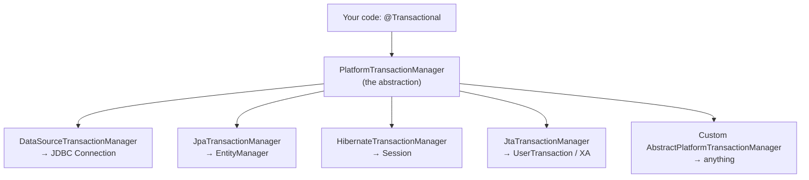
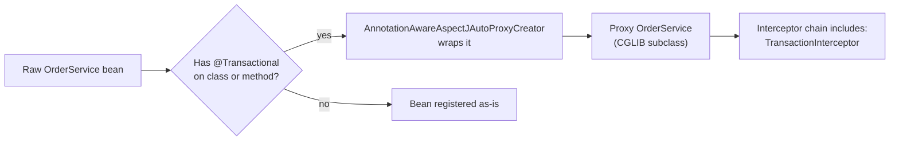
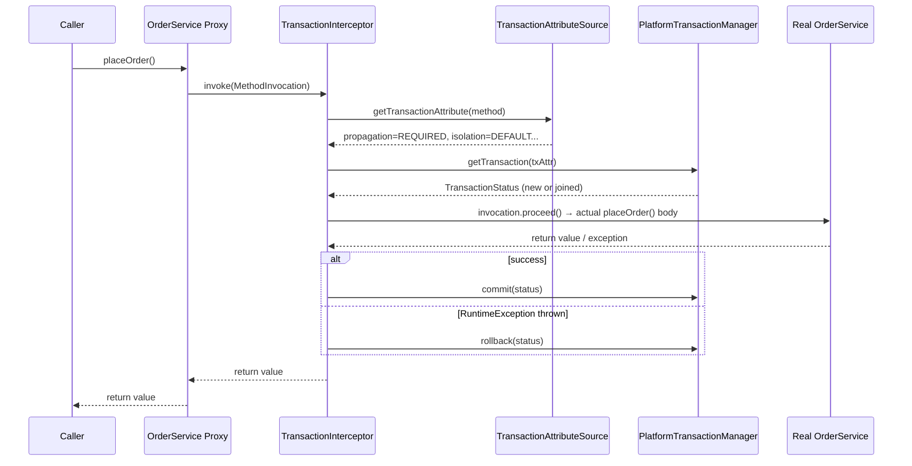
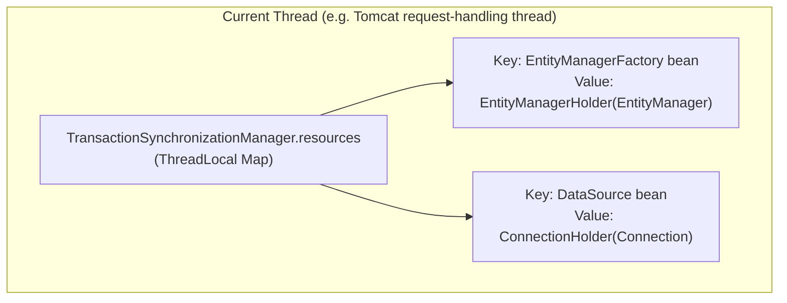
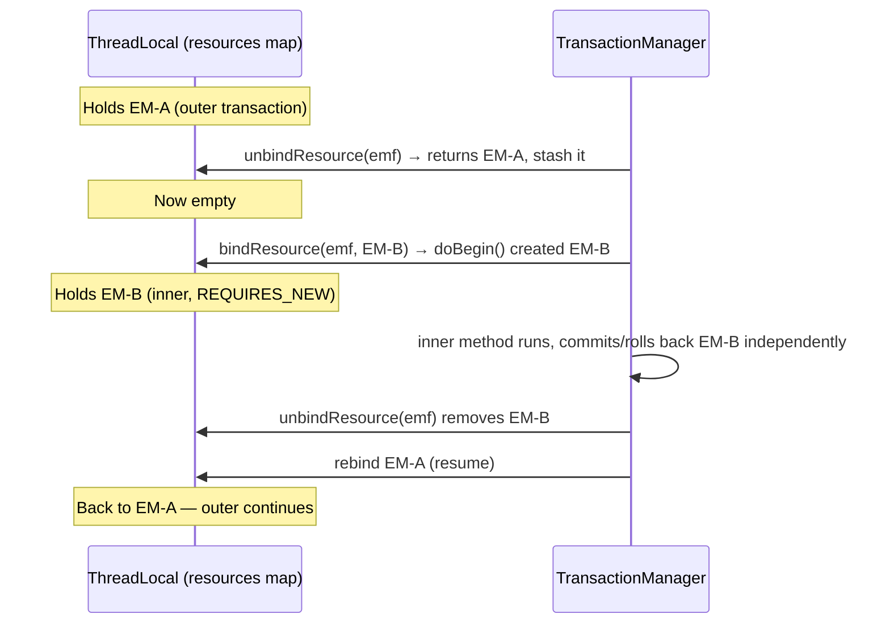
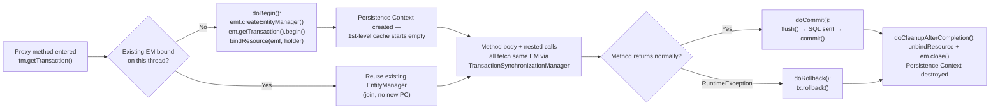
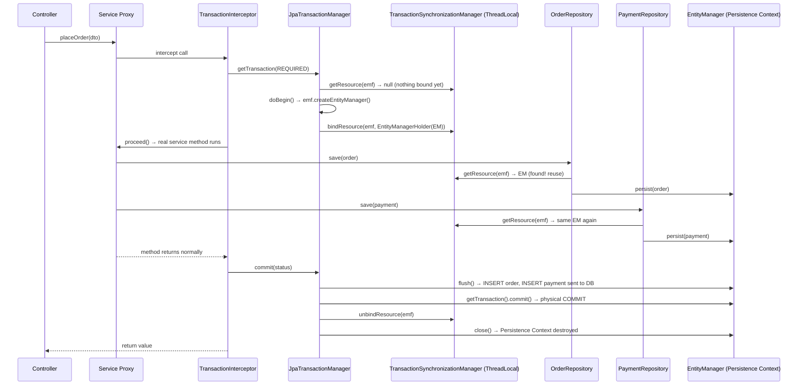
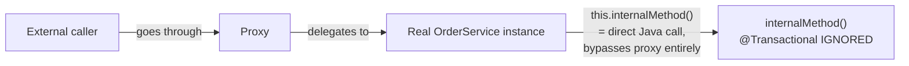

# 🔐 Spring Transaction Management — First Principles Deep Dive

> **Target reader**: someone who already gets AOP proxies, JDBC mechanics, and surface-level `@Transactional` (propagation, isolation, "same EM for same tx"). This document goes **one layer below the API** — into the actual objects, ThreadLocals, and method calls that make it work.

---

## 📑 Table of Contents

1. [Why Spring Transaction Abstraction Exists At All](#1-why)
2. [The Core Abstraction: `PlatformTransactionManager`](#2-core)
3. [How `@Transactional` Actually Executes — The Proxy Layer](#3-proxy)
4. [The ThreadLocal Engine: `TransactionSynchronizationManager`](#4-threadlocal)
5. [Propagation — What Actually Happens (Suspend/Resume)](#5-propagation)
6. [Isolation Levels — Where They Actually Get Applied](#6-isolation)
7. [`JpaTransactionManager` + Persistence Context — The Real Wiring](#7-jpa)
8. [Full Lifecycle: One Request, Start to Commit](#8-lifecycle)
9. [The Self-Invocation Trap — Now It'll Actually Click](#9-selfinvoke)
10. [Why It's Generic: JMS, JTA, Multiple Resources](#10-generic)
11. [Mental Model Cheat Sheet](#11-cheatsheet)

---

<a name="1-why"></a>
## 1️⃣ Why Spring Transaction Abstraction Exists At All

You already know it removes boilerplate:

```java
Connection conn = null;
try {
    conn = dataSource.getConnection();
    conn.setAutoCommit(false);
    // ... work ...
    conn.commit();
} catch (Exception e) {
    conn.rollback();
} finally {
    conn.close();
}
```

But that's the *shallow* answer. The **real** reason Spring built a transaction abstraction layer is:

> 🎯 **"Transaction" is not a JDBC concept. It's a concept that exists in JDBC, JPA/Hibernate, JMS, JTA (distributed/XA), and even custom resources — and Spring wanted ONE programming model (`@Transactional`, `TransactionTemplate`) that works identically regardless of *which* resource is underneath.**

Before Spring, if you switched from plain JDBC → Hibernate → JPA → a JTA-managed distributed transaction, your *transaction demarcation code* had to change too, because each technology had its own API:

| Technology | Native transaction API |
|---|---|
| JDBC | `Connection.setAutoCommit(false)` / `commit()` / `rollback()` |
| Hibernate | `Session.beginTransaction()` / `Transaction.commit()` |
| JPA | `EntityManager.getTransaction().begin()` / `commit()` |
| JTA (distributed) | `UserTransaction.begin()` / `commit()` via JNDI lookup |
| JMS | `Session.commit()` |

Spring's insight: **all of these follow the exact same state machine** — *begin → do work → commit-or-rollback → release resource*. So Spring extracted that state machine into one interface, and wrote one adapter per technology.



This is why the same `@Transactional` annotation works whether you're on plain JDBC, Spring Data JPA, or a Kafka+DB combo with `ChainedTransactionManager`. **The annotation never talks to the database. It talks to an abstraction.**

---

<a name="2-core"></a>
## 2️⃣ The Core Abstraction: `PlatformTransactionManager`

This is the actual interface (simplified):

```java
public interface PlatformTransactionManager {
    TransactionStatus getTransaction(TransactionDefinition definition) throws TransactionException;
    void commit(TransactionStatus status) throws TransactionException;
    void rollback(TransactionStatus status) throws TransactionException;
}
```

Notice something important: 🔑 **`getTransaction()` doesn't always start a new transaction.** It takes a `TransactionDefinition` (your propagation + isolation + timeout + readOnly settings) and *decides* — based on whether a transaction already exists on the current thread — whether to:

- create a brand-new one,
- join the existing one,
- suspend the existing one and create a new one,
- or throw an exception.

This decision logic is **propagation**, and it lives in one place:

```java
// AbstractPlatformTransactionManager (Spring's real base class)
public final TransactionStatus getTransaction(TransactionDefinition def) {
    Object transaction = doGetTransaction(); // technology-specific: get/create resource holder
    if (isExistingTransaction(transaction)) {
        return handleExistingTransaction(def, transaction, ...); // propagation logic here
    }
    // no existing transaction — apply propagation rules for "no tx exists" case
    return startTransaction(def, transaction, ...);
}
```

`AbstractPlatformTransactionManager` is **the actual brain**. It implements propagation, timeout, and synchronization callbacks *once*, generically. Every concrete manager (`JpaTransactionManager`, `DataSourceTransactionManager`) only implements 4 technology-specific hooks:

```java
protected abstract Object doGetTransaction();
protected abstract void doBegin(Object transaction, TransactionDefinition definition);
protected abstract void doCommit(DefaultTransactionStatus status);
protected abstract void doRollback(DefaultTransactionStatus status);
```

This is the **Template Method pattern** at the heart of Spring TX. `AbstractPlatformTransactionManager` = the algorithm skeleton. Each subclass = 4 plug-in methods for a specific resource type.

> 💡 **First-principles takeaway**: `@Transactional` doesn't know about JDBC or JPA. It knows about `PlatformTransactionManager`. The manager bean wired into your context is what decides which resource actually gets touched. Swap `JpaTransactionManager` for `DataSourceTransactionManager` and your `@Transactional` code doesn't change one bit.

---

<a name="3-proxy"></a>
## 3️⃣ How `@Transactional` Actually Executes — The Proxy Layer

You know proxies. Here's the **exact chain** for `@Transactional` specifically.

### Step A — Bean post-processing at startup

`@EnableTransactionManagement` registers `AnnotationAwareAspectJAutoProxyCreator`, a `BeanPostProcessor`. During context startup, for every bean, Spring checks: *does this class (or any method) carry `@Transactional`?*

If yes → Spring wraps the bean in a proxy (CGLIB subclass proxy, or JDK dynamic proxy if the bean only has interfaces) and registers **one specific advisor**: `BeanFactoryTransactionAttributeSourceAdvisor`.



### Step B — What's inside the proxy

The proxy holds an **interceptor chain**. For a `@Transactional` bean, that chain includes a `TransactionInterceptor` (implements `MethodInterceptor`, part of AOP Alliance). When you call `orderService.placeOrder()` from outside, you're actually calling the **proxy's** `placeOrder()`, which routes through this interceptor.

### Step C — `TransactionInterceptor.invoke()`

This is the real method that runs on every call to a `@Transactional` method:

```java
public Object invoke(MethodInvocation invocation) throws Throwable {
    return invokeWithinTransaction(invocation.getMethod(), targetClass, invocation::proceed);
}
```

And `invokeWithinTransaction` (the core logic, simplified to what matters):

```java
TransactionAttribute txAttr = getTransactionAttributeSource()
        .getTransactionAttribute(method, targetClass); // reads @Transactional's propagation/isolation/etc

PlatformTransactionManager tm = determineTransactionManager(txAttr);

TransactionInfo txInfo = createTransactionIfNecessary(tm, txAttr, joinpointIdentification);
// ↑ this internally calls tm.getTransaction(txAttr) — Section 2!

Object retVal;
try {
    retVal = invocation.proceed(); // 🎯 YOUR ACTUAL METHOD BODY RUNS HERE
} catch (Throwable ex) {
    completeTransactionAfterThrowing(txInfo, ex); // checks rollback rules, may rollback or commit
    throw ex;
} finally {
    cleanupTransactionInfo(txInfo); // restore previous TransactionInfo on ThreadLocal
}
commitTransactionAfterReturning(txInfo); // tm.commit(status)
return retVal;
```

So the full picture:



> 💡 **This is why `@Transactional` is "just AOP"** — but now you can see it's not magic, it's a `MethodInterceptor` sitting in a proxy's call chain, delegating to `PlatformTransactionManager.getTransaction()` before your method and `.commit()`/`.rollback()` after.

---

<a name="4-threadlocal"></a>
## 4️⃣ The ThreadLocal Engine: `TransactionSynchronizationManager`

This is the piece most people skip, and it's the **actual answer to "how does the same EntityManager get reused across the same transaction."**

`TransactionSynchronizationManager` is a class full of **static `ThreadLocal` fields**:

```java
public abstract class TransactionSynchronizationManager {
    private static final ThreadLocal<Map<Object, Object>> resources = new NamedThreadLocal<>("Transactional resources");
    private static final ThreadLocal<Set<TransactionSynchronization>> synchronizations = ...;
    private static final ThreadLocal<String> currentTransactionName = ...;
    private static final ThreadLocal<Boolean> currentTransactionReadOnly = ...;
    private static final ThreadLocal<Integer> currentTransactionIsolationLevel = ...;
    private static final ThreadLocal<Boolean> actualTransactionActive = ...;
}
```

🔑 **`resources` is a `Map<Object, Object>` bound per-thread.** The **key** is the *resource factory* (e.g. the `DataSource` bean, or the `EntityManagerFactory` bean) and the **value** is a *resource holder* (e.g. `ConnectionHolder` wrapping a JDBC `Connection`, or `EntityManagerHolder` wrapping an `EntityManager`).



This is **the actual mechanism** behind "same EM/same Connection reused within one transaction":

- When `JpaTransactionManager.doBegin()` runs, it creates an `EntityManager`, wraps it in an `EntityManagerHolder`, and calls `TransactionSynchronizationManager.bindResource(emf, holder)`.
- Every time your code — or Spring Data JPA's repository proxy — asks "give me the EntityManager for this `EntityManagerFactory`," it goes through `EntityManagerFactoryUtils.getTransactionalEntityManager(emf)`, which does `TransactionSynchronizationManager.getResource(emf)` **first**, before ever creating a new one.
- If a holder is already bound to the current thread → **reuse it**. That's the entire trick. No global registry, no shared object across threads — just a `ThreadLocal<Map>` scoped to the running thread, populated at `doBegin()` and cleared at commit/rollback.

```java
// Simplified real logic inside EntityManagerFactoryUtils
public static EntityManager getTransactionalEntityManager(EntityManagerFactory emf) {
    EntityManagerHolder emHolder =
        (EntityManagerHolder) TransactionSynchronizationManager.getResource(emf);
    if (emHolder != null) {
        return emHolder.getEntityManager(); // ✅ reuse — same persistence context
    }
    return null; // no active transaction-bound EM — caller may create a new detached one
}
```

> 💡 **This is why EM sharing works across layers**: `OrderService` calls `OrderRepository` calls `PaymentRepository` — all in the same thread, same transaction. Every repository proxy, when it needs an `EntityManager`, asks `TransactionSynchronizationManager` for the thread-bound one first. They all get the *literal same object*, hence *same persistence context*, hence first-level cache hits and no N+1 surprises across repos in one `@Transactional` method.

---

<a name="5-propagation"></a>
## 5️⃣ Propagation — What Actually Happens (Suspend/Resume)

Propagation isn't a flag that's "checked" — it's a **branch in `handleExistingTransaction()`** inside `AbstractPlatformTransactionManager`. Let's go through what really happens for the propagations you use most.

### `REQUIRED` (default)
```java
if (isExistingTransaction) {
    return existing; // just join — no new doBegin() call, no new resource holder
}
```
No suspension. No new connection. Your method runs *inside* the caller's transaction. Commit/rollback authority stays with the **outermost** `@Transactional` boundary (this is why an inner `REQUIRED` method's rollback can still get overridden/ignored if the outer catches the exception — the physical commit only happens at the outermost proxy boundary).

### `REQUIRES_NEW`
```java
if (isExistingTransaction) {
    Object suspendedResources = suspend(existing); // 👈 the interesting part
    try {
        return startTransaction(def, transaction, ...); // brand new doBegin()
    } catch (Exception e) {
        resume(existing, suspendedResources);
        throw e;
    }
}
```

`suspend()` is doing real work:
1. It calls `TransactionSynchronizationManager.unbindResource(resourceKey)` — **physically removes** the current EM/Connection holder from the ThreadLocal map and stashes it in a `SuspendedResourcesHolder` object.
2. It suspends all registered `TransactionSynchronization` callbacks too.
3. Then `doBegin()` runs fresh — a **new** `EntityManager`/`Connection` gets created and bound to the (now-empty) ThreadLocal slot.

This is why `REQUIRES_NEW` genuinely opens a second physical DB transaction/connection — it's not simulated, the old resource is *literally unplugged from the thread* and a new one plugged in. When the inner transaction commits or rolls back, `resume()` puts the original holder back.



### `NESTED`
Different mechanism entirely — no suspend/resume, no new physical transaction. Uses **JDBC savepoints** (`Connection.setSavepoint()`) if the driver supports them. `doBegin` isn't re-invoked; instead a savepoint is created on the *same* connection, and rollback of the nested tx does `Connection.rollback(savepoint)` instead of a full rollback. This is why `NESTED` doesn't work with `JpaTransactionManager` + certain setups unless `nestedTransactionAllowed` is true and the underlying JDBC driver supports savepoints — it's a connection-level feature, not a manager-level one.

### `MANDATORY` / `NEVER` / `NOT_SUPPORTED` / `SUPPORTS`
These are pure **guard clauses** in `handleExistingTransaction()` / the "no existing transaction" branch — no resource work at all:
- `MANDATORY` + no existing tx → throw `IllegalTransactionStateException`
- `NEVER` + existing tx → throw `IllegalTransactionStateException`
- `NOT_SUPPORTED` + existing tx → suspend it, run with **no transaction** (autocommit-ish), resume after
- `SUPPORTS` → just run with whatever is/isn't already there, no enforcement

---

<a name="6-isolation"></a>
## 6️⃣ Isolation Levels — Where They Actually Get Applied

Isolation level is **not a Spring concept** — Spring just forwards it to `Connection.setTransactionIsolation(int level)` (plain JDBC constant, e.g. `Connection.TRANSACTION_READ_COMMITTED`). This happens inside `doBegin()`:

```java
// DataSourceTransactionManager.doBegin() — simplified real logic
Connection con = obtainDataSource().getConnection();
Integer previousIsolationLevel = DataSourceUtils.prepareConnectionForTransaction(con, definition);
// ↑ internally: if (definition.getIsolationLevel() != ISOLATION_DEFAULT)
//                  con.setTransactionIsolation(definition.getIsolationLevel());
con.setAutoCommit(false);
txObject.setConnectionHolder(new ConnectionHolder(con), true);
```

So:
- `@Transactional(isolation = READ_COMMITTED)` → Spring maps the enum to the JDBC int constant → calls `connection.setTransactionIsolation(2)` **once, right when the physical connection for this transaction is obtained** → then restores the connection's *previous* isolation level when the connection is released back to the pool (so you don't leak isolation settings to the next borrower).
- For `JpaTransactionManager`: it does the same thing, but has to reach **through** the `EntityManager` down to the underlying JDBC `Connection` via `((SessionImpl) session).connection()` (Hibernate) or a `JpaDialect` hook — because JPA itself has **no isolation-level API**. This is a good example of "JPA is a spec that doesn't cover everything Spring needs" — Spring's `JpaDialect` interface exists specifically to let each JPA provider (Hibernate, EclipseLink) expose vendor escape hatches like getting the raw `Connection`.
- ⚠️ Isolation is a **connection-scoped**, not transaction-object-scoped, setting. That's why you can't change isolation mid-transaction, and why nested/nested-`REQUIRED` calls with *different declared isolation levels* either get ignored (join wins, inner declaration is irrelevant) or throw, depending on `validateExistingTransaction` config.

---

<a name="7-jpa"></a>
## 7️⃣ `JpaTransactionManager` + Persistence Context — The Real Wiring

This is the section that answers "how does JPA get associated with Spring TX, in depth."

### The four hook methods, for real this time

```java
public class JpaTransactionManager extends AbstractPlatformTransactionManager {

    protected Object doGetTransaction() {
        JpaTransactionObject txObject = new JpaTransactionObject();
        EntityManagerHolder emHolder = (EntityManagerHolder)
            TransactionSynchronizationManager.getResource(getEntityManagerFactory());
        txObject.setEntityManagerHolder(emHolder, false); // false = "not newly created by me"
        return txObject;
    }

    protected void doBegin(Object transaction, TransactionDefinition definition) {
        JpaTransactionObject txObject = (JpaTransactionObject) transaction;
        EntityManager em = createEntityManagerForTransaction(); // emf.createEntityManager()
        EntityTransaction tx = em.getTransaction();
        tx.begin(); // 🎯 JPA-native "begin" — delegates to Hibernate Session txn
        // reach through to the physical Connection to set isolation, if requested
        applyIsolationLevel(txObject, definition.getIsolationLevel());
        EntityManagerHolder holder = new EntityManagerHolder(em);
        txObject.setEntityManagerHolder(holder, true);
        TransactionSynchronizationManager.bindResource(getEntityManagerFactory(), holder); // 🔑 THE bind
    }

    protected void doCommit(DefaultTransactionStatus status) {
        EntityManagerHolder holder = ((JpaTransactionObject) status.getTransaction()).getEntityManagerHolder();
        holder.getEntityManager().getTransaction().commit(); // flush + physical commit happens here
    }

    protected void doRollback(DefaultTransactionStatus status) {
        EntityManagerHolder holder = ((JpaTransactionObject) status.getTransaction()).getEntityManagerHolder();
        holder.getEntityManager().getTransaction().rollback();
    }

    protected void doCleanupAfterCompletion(Object transaction) {
        TransactionSynchronizationManager.unbindResource(getEntityManagerFactory()); // unbind
        EntityManager em = ((JpaTransactionObject) transaction).getEntityManagerHolder().getEntityManager();
        em.close(); // persistence context dies HERE
    }
}
```

### Why `doGetTransaction()` matters most

Notice `doGetTransaction()` runs **before** we even know if we're starting new or joining. It checks the ThreadLocal *first*. If a holder already exists (we're the inner call of a `REQUIRED` chain), `isExistingTransaction()` returns true, and `handleExistingTransaction()` (Section 5) just **reuses** that transaction object — `doBegin()` never runs again. That's the actual code path that makes "same EM for the whole transaction, across every repository call" true. It's not that Spring "remembers" your service method — it's that every entry into a `@Transactional`-proxied method re-checks the same ThreadLocal slot.

### Persistence Context lifecycle = Transaction lifecycle (for `@Transactional`-scoped EMs)



This is **why dirty checking works without explicit `save()` calls**: the `EntityManager`/persistence context stays open and *is the same object* for the full duration of the transaction. Any managed entity you mutate is tracked by that one `EntityManager`'s persistence context, and `flush()` (triggered automatically right before `tx.commit()`, or earlier by JPQL/native queries) diffs the entity's current state against the snapshot taken at load time, generating `UPDATE` statements for you.

And it's **why you get `LazyInitializationException` outside the transaction**: once `doCleanupAfterCompletion()` runs, `em.close()` is called. The persistence context is gone. Any lazy proxy that hasn't been initialized yet has no live `EntityManager` to fetch through anymore.

### `@Transactional(readOnly = true)` — what it actually triggers for JPA
- Hibernate: sets `FlushMode.MANUAL` (or `COMMIT` depending on version) on the session, so dirty-checking flushes are skipped — a real perf win, not just documentation.
- Some drivers: `Connection.setReadOnly(true)` propagates to the DB driver, which *may* route to a read replica or skip write-lock acquisition, depending on driver/DB support.
- It does **not** stop you from calling `.persist()` — Spring doesn't enforce read-only at the Java level, it's a *hint* passed down the stack; whether it's enforced depends on JPA provider + driver + DB.

---

<a name="8-lifecycle"></a>
## 8️⃣ Full Lifecycle: One Request, Start to Commit

Putting Sections 3, 4, 5, 7 together — a `Controller → Service(@Transactional) → Repository → Repository` call, on one thread:



Every arrow into `TSM` in the middle of this diagram is the **exact same ThreadLocal lookup**. That's the entire "magic."

---

<a name="9-selfinvoke"></a>
## 9️⃣ The Self-Invocation Trap — Now It'll Actually Click

You've probably hit this: calling `this.someTransactionalMethod()` from within the same class doesn't start/join a transaction as expected. Now that you've seen the proxy mechanism, the reason is mechanical, not mysterious:



`this` inside the real (unproxied) target object is a reference to **itself**, not to the CGLIB proxy wrapping it. Calling `this.method()` is a plain JVM `invokevirtual` — it never re-enters `TransactionInterceptor.invoke()`, so `getTransaction()`/`commit()`/`rollback()` never run for that call. The `@Transactional` annotation on `internalMethod()` is only ever *read* by the `TransactionAttributeSource` when a call comes in **through the proxy** from outside.

Fixes, in order of how they actually work:
1. **Split into a separate bean** — call from a different, proxied bean → goes through the proxy correctly.
2. **Self-inject the proxy**: `@Autowired private OrderService self;` then call `self.internalMethod()` — Spring injects the *proxy* into the field, so the call routes through `TransactionInterceptor` correctly.
3. **`AopContext.currentProxy()`** with `exposeProxy=true` — get the proxy reference programmatically mid-method.

---

<a name="10-generic"></a>
## 🔟 Why It's Generic: JMS, JTA, Multiple Resources

Since `@Transactional` only talks to `PlatformTransactionManager`, and `AbstractPlatformTransactionManager` only needs 4 hook methods implemented, Spring ships managers for resources that have nothing to do with a relational DB:

- **`JmsTransactionManager`** — `doBegin`/`doCommit` wrap a JMS `Session`'s commit/rollback. Useful for `@Transactional` message listeners.
- **`JtaTransactionManager`** — delegates to a JNDI-looked-up `javax.transaction.UserTransaction`, letting **multiple resources** (two different DBs, or a DB + a JMS queue) commit atomically via two-phase commit (XA). This is the case where "transaction" clearly can't mean "one JDBC connection" — it means a *coordinated outcome across independent resource managers*.
- **`ChainedTransactionManager`** — best-effort (non-XA) coordination across several `PlatformTransactionManager`s, e.g. commit DB txn then Kafka producer txn, in sequence, with manual compensation on partial failure.

This is the strongest proof of "why generic": if Spring TX were JDBC-specific, none of these could exist under the same `@Transactional` annotation. The annotation, the proxy, the interceptor, and the propagation/isolation semantics are **100% resource-agnostic** — only the 4 `do*` hook methods know what kind of resource is actually being committed.

---

<a name="11-cheatsheet"></a>
## 🧠 Mental Model Cheat Sheet

| Question | Real answer |
|---|---|
| What actually intercepts the call? | `TransactionInterceptor` (a `MethodInterceptor`) inside a CGLIB/JDK proxy, installed by `AnnotationAwareAspectJAutoProxyCreator` |
| Where does propagation logic live? | `AbstractPlatformTransactionManager.handleExistingTransaction()` — one method, shared by every manager type |
| How is the same EM reused across repos in one transaction? | `TransactionSynchronizationManager.resources` — a per-thread `ThreadLocal<Map<Object,Object>>`, keyed by `EntityManagerFactory`, bound in `doBegin()`, read via `getResource()` |
| What does `REQUIRES_NEW` really do? | `unbindResource()` the current holder (stash it), run fresh `doBegin()`, then `resume()` (rebind) the stashed holder after |
| What does `NESTED` really do? | JDBC `Connection.setSavepoint()` on the *same* connection — no suspend/resume, no new EM |
| Where does isolation level get applied? | `Connection.setTransactionIsolation(int)`, called once inside `doBegin()`, restored after the connection is released |
| Why does persistence-context-scoped caching "just work"? | Because it's the literal same `EntityManager` Java object for the whole transaction — not a caching layer, just object reuse |
| Why does `this.method()` skip `@Transactional`? | Self-calls bypass the proxy — `TransactionInterceptor.invoke()` never runs |
| Why is it "generic," not JDBC-only? | `@Transactional` → `PlatformTransactionManager` interface only. JDBC, JPA, JMS, JTA managers are interchangeable plug-ins implementing 4 hook methods |

---

📌 **One-line summary to remember**: *`@Transactional` is a proxy that calls `PlatformTransactionManager.getTransaction()`/`commit()`/`rollback()` around your method; propagation is just branching logic on a `ThreadLocal`-bound resource holder; and "same EM for the same transaction" is nothing more than `TransactionSynchronizationManager` handing back the same object it stashed in a `ThreadLocal` map at `doBegin()`.*