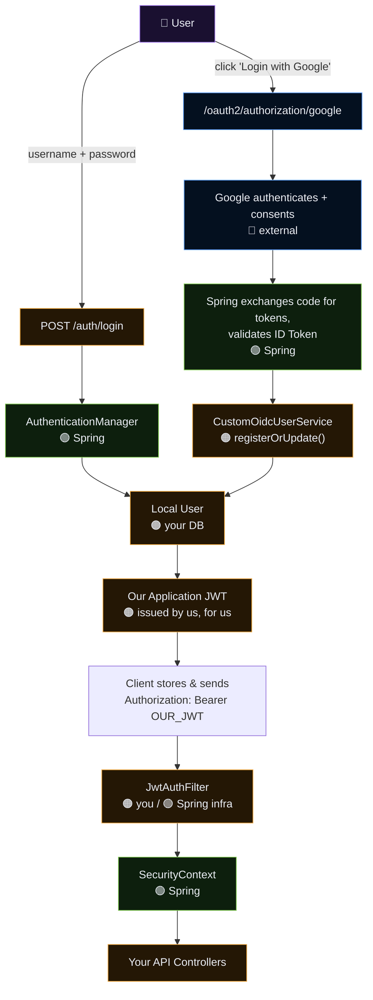
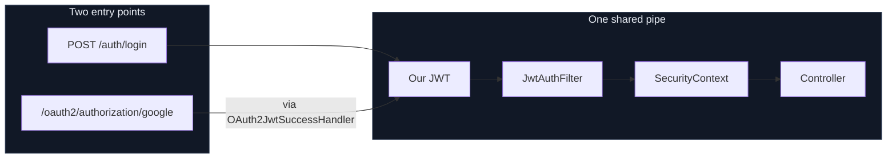

# 🔐 Spring Security + OAuth2 / OIDC — First Principles Deep Dive

> **Goal:** Understand OAuth2 and OpenID Connect from first principles — not just memorize `oauth2Login()`, Google configuration, or Spring Security classes.

This README continues from the previous **Spring Security + JWT** mental model.

---

<details>
<summary>🧭 Click to see the JWT → OAuth2 transition</summary>

## From JWT to OAuth2/OIDC

With our own JWT authentication system, we had:

```text
USER
 │
 │ username + password
 ▼
OUR APPLICATION
 │
 ├── authenticate user
 ├── generate JWT
 └── return JWT
        │
        ▼
      CLIENT
        │
        │ Authorization: Bearer JWT
        ▼
OUR APPLICATION
        │
        ▼
Authentication
        │
        ▼
SecurityContext
        │
        ▼
Authorization
```

The problem is:

> **What if we don't want our application to handle the user's password at all?**

Imagine our application wants:

- Login with Google
- User's name/email
- Access to Google Calendar
- Maybe read calendar events
- Maybe create calendar events

But the user does **not** trust our application enough to give us their Google password.

Instead:

```text
User
 │
 │ trusts Google
 ▼
Google
 │
 │ authenticates user
 │ asks user for consent
 ▼
Google gives our application
limited authorization
```

So OAuth2 introduces:

> **Delegated authorization.**

The user does not give our application their Google password.

Instead, the user authorizes our application through Google.

OAuth2 defines the authorization framework for obtaining limited access to protected resources. OIDC adds an identity/authentication layer on top of OAuth2.

</details>

---

# 📚 Table of Contents

<details>
<summary>Click to expand</summary>

1. [The Problem OAuth2 Solves](#1--the-problem-oauth2-solves)
2. [OAuth2 vs JWT vs OIDC](#2--oauth2-vs-jwt-vs-oidc)
3. [The Four OAuth2 Roles](#3--the-four-oauth2-roles)
4. [Google Calendar Example](#4--google-calendar-example)
5. [Scopes](#5--scopes)
6. [Consent](#6--consent)
7. [OAuth2 Tokens](#7--oauth2-tokens)
8. [Authorization Code Flow](#8--authorization-code-flow)
9. [Why the Authorization Code Exists](#9--why-the-authorization-code-exists)
10. [The `state` Parameter](#10--the-state-parameter)
11. [PKCE](#11--pkce)
12. [How PKCE Actually Protects the Code](#12--how-pkce-actually-protects-the-code)
13. [Client ID and Client Secret](#13--client-id-and-client-secret)
14. [Redirect URI](#14--redirect-uri)
15. [Authorization Endpoint](#15--authorization-endpoint)
16. [Token Endpoint](#16--token-endpoint)
17. [Access Token](#17--access-token)
18. [Refresh Token](#18--refresh-token)
19. [OpenID Connect](#19--openid-connect)
20. [ID Token](#20--id-token)
21. [ID Token vs Access Token](#21--id-token-vs-access-token)
22. [`openid`, `profile`, `email` Scopes](#22--openid-profile-email-scopes)
23. [`nonce`](#23--nonce)
24. [Complete OAuth2 + OIDC Flow](#24--complete-oauth2--oidc-flow)
24. [🛠️ OAuth2 Setup — Step-by-Step (Beginner Guide)](#️-oauth2-setup--step-by-step-beginner-guide)
25. [Spring Security OAuth2 Client](#25--spring-security-oauth2-client)
26. [Spring Security Filter Flow](#26--spring-security-filter-flow)
27. [`ClientRegistration`](#27--clientregistration)
28. [`OAuth2UserService` / `OidcUserService`](#28--oauth2userservice--oidcuserservice)
29. [Custom OIDC User Service](#29--custom-oidc-user-service)
30. [Local User Database Design](#30--local-user-database-design)
31. [The Code Shown in This Project](#31--the-code-shown-in-this-project)
32. [What Spring Security Does For Us](#32--what-spring-security-does-for-us)
33. [OAuth2 Login vs OAuth2 Client](#33--oauth2-login-vs-oauth2-client)
34. [OAuth2 Resource Server](#34--oauth2-resource-server)
35. [OAuth2 + JWT Relationship](#35--oauth2--jwt-relationship)
36. [OAuth2 Grant Types](#36--oauth2-grant-types)
37. [Security Threats](#37--security-threats)
38. [Production Security](#38--production-security)
39. [Session-Based OAuth2 Login](#39--session-based-oauth2-login)
40. [Combining Normal JWT Login + OAuth2 Login](#40--combining-normal-jwt-login--oauth2-login)
41. [Making OAuth2 Login Stateless](#41--making-oauth2-login-stateless)
42. [Architecture Options](#42--architecture-options)
43. [Final Unified Mental Model](#43--final-unified-mental-model)
44. [Experiments](#44--experiments)
45. [Final Cheat Sheet](#45--final-cheat-sheet)
46. [🔀 Combining JWT + OAuth2 — Complete Working Setup](#-combining-jwt--oauth2--complete-working-setup)

</details>

---

# 1. 🧠 The Problem OAuth2 Solves

Suppose we build:

```text
Calendar Application
```

We want users to:

```text
Login with Google
        +
Read Google Calendar
        +
Create Google Calendar events
```

A naive approach would be:

```text
"Give us your Google email and password."
```

This is terrible.

The user should not give our application their Google password.

Why?

Because then our application could potentially:

```text
read email
change password
access Drive
access Calendar
access Contacts
etc.
```

And the user has no granular control.

Instead:

```text
USER
 │
 │ "I trust Google"
 ▼
GOOGLE
 │
 │ authenticates user
 │
 │ asks:
 │
 │ "Do you allow this application
 │  to read your calendar?"
 │
 ▼
USER CONSENTS
 │
 ▼
GOOGLE
 │
 │ issues limited authorization
 ▼
OUR APPLICATION
```

This is the fundamental idea behind OAuth2:

> **The Resource Owner delegates limited access to a Client without giving the Client their credentials.**

OAuth2 is therefore primarily an **authorization framework**, not an authentication protocol.

---

# 2. ⚔️ OAuth2 vs JWT vs OIDC

This distinction is extremely important.

## OAuth2

```text
OAuth2
   ↓
Protocol / authorization framework
   ↓
How a client obtains delegated authorization
```

It answers:

> **What is this application allowed to access?**

---

## JWT

```text
JWT
   ↓
Token format
   ↓
HEADER.PAYLOAD.SIGNATURE
```

JWT can be used as an OAuth2 access token, but OAuth2 does **not** require access tokens to be JWTs.

An access token can also be opaque.

```text
OAuth2
   │
   └── Access Token
          │
          ├── JWT
          │
          └── Opaque token
```

---

## OpenID Connect

OAuth2 itself does not standardize how a client learns:

> "Who exactly authenticated?"

OIDC adds that identity layer.

```text
OAuth2
   ↓
Authorization

OIDC
   ↓
Authentication + Identity
   ↓
built on OAuth2
```

OpenID Connect describes itself as an identity layer on top of OAuth2 and uses the `openid` scope to request that authentication capability.

---

# 3. 👥 The Four OAuth2 Roles

OAuth2 becomes much easier once these four roles are clear.

```text
┌───────────────────────┐
│   Resource Owner      │
│       USER            │
└──────────┬────────────┘
           │
           │ grants permission
           ▼
┌───────────────────────┐
│ Authorization Server  │
│       GOOGLE          │
└──────────┬────────────┘
           │
           │ issues token
           ▼
┌───────────────────────┐
│        CLIENT         │
│  OUR SPRING APP       │
└──────────┬────────────┘
           │
           │ Access Token
           ▼
┌───────────────────────┐
│   Resource Server     │
│ Google Calendar API   │
└───────────────────────┘
```

> 🎨 **Visual version** *(renders on GitHub / VS Code — click to expand if collapsed)*
>
> ```mermaid
> flowchart TD
>     RO["👤 Resource Owner<br/><b>USER</b><br/>owns the data"]
>     AS["🔐 Authorization Server<br/><b>GOOGLE</b><br/>authenticates + issues tokens"]
>     C["🖥️ Client<br/><b>OUR SPRING APP</b><br/>requests access"]
>     RS["📦 Resource Server<br/><b>Google Calendar API</b><br/>hosts protected data"]
>
>     RO -- "grants permission" --> AS
>     AS -- "issues token" --> C
>     C -- "presents Access Token" --> RS
>
>     style RO fill:#1a1030,stroke:#b48cff,color:#e9edf5
>     style AS fill:#04101f,stroke:#5b9dff,color:#e9edf5
>     style C fill:#0d1f0d,stroke:#7ec850,color:#e9edf5
>     style RS fill:#241705,stroke:#f0a840,color:#e9edf5
> ```

## 3.1 Resource Owner 👤

Usually:

```text
User
```

The person who owns the protected resource.

Example:

```text
Sagar's Google Calendar
```

The user can authorize a client to access it.

---

## 3.2 Client 🖥️

The application requesting access.

Here:

```text
Our Spring Boot application
```

The client is **not** the user.

It is the application acting on behalf of the user.

---

## 3.3 Authorization Server 🔐

The server responsible for:

- authenticating the Resource Owner
- obtaining authorization/consent
- issuing authorization credentials/tokens

Here:

```text
Google
```

OAuth2 defines the authorization endpoint and token endpoint as key authorization-server endpoints.

---

## 3.4 Resource Server 📦

The server hosting protected resources.

Example:

```text
Google Calendar API
```

The Resource Server receives an access token and decides whether that token permits the requested operation.

---

# 4. 📅 Google Calendar Example

Suppose:

```text
User = Sagar

Client = Event Application

Authorization Server = Google

Resource Server = Google Calendar API
```

The user says:

> "I want to log into your application using Google and allow it to read my Google Calendar."

The flow becomes:

```text
                    USER
                     │
                     │
                     ▼
             OUR SPRING APP
                  CLIENT
                     │
                     │ authorization request
                     ▼
                  GOOGLE
           Authorization Server
                     │
              ┌──────┴──────┐
              │             │
          Login          Consent
              │             │
              └──────┬──────┘
                     │
                     │ Authorization Code
                     ▼
             OUR SPRING APP
                     │
                     │ code → token endpoint
                     ▼
                  GOOGLE
                     │
              Access Token
              ID Token (OIDC)
                     │
                     ▼
             OUR SPRING APP
                     │
                     │ Access Token
                     ▼
          Google Calendar API
             Resource Server
```

### Important correction

Google does **not** simply give the token "to the Resource Server for the Client."

The Client receives/obtains the access token and then presents it to the Resource Server.

```text
Authorization Server
        │
        │ issues
        ▼
     CLIENT
        │
        │ presents Access Token
        ▼
 Resource Server
```

That distinction matters.

---

# 5. 🎯 Scopes

The client should not ask:

> "Give me everything."

Instead it asks for specific permissions.

Example:

```text
scope = calendar.read
```

or provider-specific scopes such as:

```text
calendar.readonly
calendar.events
```

The exact scope names depend on the provider/API.

Conceptually:

```text
scope
  ↓
requested permissions
  ↓
user consent
  ↓
authorization grant
  ↓
access token
```

Example:

```text
Application asks:

"May I read your calendar?"
```

User:

```text
YES
```

Then the resulting authorization is limited to the granted scopes.

---

# 6. 🤝 Consent

Consent is the Resource Owner saying:

> "I authorize this Client to access these resources with these permissions."

Example:

```text
Application:
"MyCalendarApp"

Requests:

✓ Read calendar
✓ View basic profile

Does NOT request:

✗ Delete account
✗ Read Gmail
✗ Access Drive
```

The user can trust Google to enforce this boundary.

The application never needs:

```text
Google password
```

OAuth2's purpose is precisely to let clients obtain limited access without requiring the Resource Owner to disclose credentials to the client.

---

# 7. 🎟️ OAuth2 Tokens

OAuth2 introduces several credentials with different jobs.

```text
Authorization Code
        ↓
temporary credential
        ↓
exchange
        ↓
Access Token
        ↓
access protected resource
```

Potentially:

```text
Refresh Token
        ↓
obtain new Access Token
```

OIDC additionally introduces:

```text
ID Token
        ↓
identity/authentication information
```

---

# 8. 🔄 Authorization Code Flow

The most important OAuth2 flow for this README is:

```text
Authorization Code Flow
```

The high-level process:

```text
1. Client creates authorization request

2. Browser is redirected to Authorization Server

3. Authorization Server authenticates user

4. Authorization Server asks for consent

5. Authorization Server returns Authorization Code

6. Browser reaches Client's redirect URI

7. Client sends Code to Token Endpoint

8. Authorization Server validates request

9. Authorization Server returns tokens

10. Client uses Access Token to access Resource Server
```

RFC 6749 defines the authorization endpoint as the endpoint used to obtain authorization via user-agent redirection and the token endpoint as the endpoint used to exchange an authorization grant for an access token.

---

# 9. 🤔 Why the Authorization Code Exists

This is one of the most important OAuth2 concepts.

Why not:

```text
Browser
   ↓
Google
   ↓
Access Token
   ↓
Browser
   ↓
Our Application
```

Because the browser is an exposed environment.

Instead:

```text
Browser
   ↓
Google
   ↓
Authorization Code
   ↓
Browser
   ↓
Our Backend
   ↓
Token Endpoint
   ↓
Access Token
```

The browser only transports a short-lived authorization code.

The actual token exchange happens through the Client's backend.

```text
                  BROWSER
                     │
                     │ code
                     ▼
                 BACKEND
                     │
                     │ server-to-server
                     ▼
             TOKEN ENDPOINT
                     │
                     ▼
                ACCESS TOKEN
```

This greatly reduces token exposure.

Modern OAuth security guidance recommends authorization code flows and discourages exposing access tokens in authorization responses/URLs.

---

# 10. 🛡️ The `state` Parameter

Suppose our application sends:

```text
state = ABC123_RANDOM
```

Google eventually returns:

```text
?code=XYZ
&state=ABC123_RANDOM
```

Our application checks:

```text
state we generated
        ==
state returned
```

If:

```text
ABC123_RANDOM
==
ABC123_RANDOM
```

continue.

If:

```text
ABC123_RANDOM
!=
ATTACKER_VALUE
```

reject.

## Why?

Because OAuth is a browser redirect flow.

We need to correlate:

```text
Authorization Request A
          ↓
Authorization Response A
```

without allowing an attacker to inject a response from another authorization transaction.

Conceptually:

```text
Browser starts Login A
        │
        ▼
Authorization Server
        │
        ▼
Browser returns
        │
        ▼
Our Application

state proves:

"This response belongs to
the authorization request I started."
```

`state` is also an important CSRF/request-correlation mechanism.

---

# 11. 🔑 PKCE

Even with authorization codes, we need protection against authorization-code interception and injection.

This is where:

```text
PKCE
```

comes in.

PKCE:

> **Proof Key for Code Exchange**

The Client generates a secret random value:

```text
code_verifier
```

Then derives:

```text
code_challenge
```

Conceptually:

```text
code_verifier
      │
      │ SHA-256
      ▼
code_challenge
```

The Client sends:

```text
code_challenge
```

during the authorization request.

The Client keeps:

```text
code_verifier
```

until the token exchange.

---

# 12. 🔐 How PKCE Actually Protects the Code

This is the part that is easy to misunderstand.

### Step 1 — Client creates verifier

```text
Client

code_verifier =
random_secret_value
```

This is high-entropy random data.

---

### Step 2 — Client derives challenge

```text
code_verifier
      │
      ▼
SHA-256
      │
      ▼
Base64URL
      │
      ▼
code_challenge
```

---

### Step 3 — Authorization request

The browser goes to Google with:

```text
client_id
redirect_uri
scope
response_type=code
state
code_challenge
code_challenge_method=S256
```

Notice:

```text
code_challenge
```

is exposed.

That is okay.

The secret is:

```text
code_verifier
```

which remains with the Client.

RFC 7636 explicitly relies on the attacker not learning the verifier and recommends a cryptographically random verifier; current OAuth security guidance recommends `S256`.

---

### Step 4 — Google remembers the challenge

Google associates:

```text
Authorization Code
       +
code_challenge
```

---

### Step 5 — Google redirects back

```text
https://ourapp.com/login/oauth2/code/google
        ?code=AUTH_CODE
        &state=ABC123
```

---

### Step 6 — Backend sends token request

Our backend sends:

```text
code=AUTH_CODE
client_id=...
client_secret=...
redirect_uri=...
code_verifier=ORIGINAL_SECRET
```

---

### Step 7 — Google calculates again

Google takes:

```text
received code_verifier
        ↓
SHA-256
        ↓
Base64URL
        ↓
new challenge
```

Then:

```text
new challenge
      ==
stored challenge
```

If yes:

```text
TOKEN ISSUED
```

If no:

```text
REJECT
```

---

## 🧠 The security insight

An attacker may steal:

```text
Authorization Code
```

But does not know:

```text
code_verifier
```

Therefore:

```text
stolen code
   +
no verifier
   =
cannot redeem code
```

This is the core PKCE idea.

And importantly:

> **The `code_challenge` does not need to be secret. The `code_verifier` does.**

Current OAuth security guidance requires authorization servers to support PKCE and requires public clients to use it; PKCE is also recommended for confidential clients.

---

# 13. 🪪 Client ID and Client Secret

Before OAuth starts, our application registers with Google.

Google gives:

```text
client_id
client_secret
```

Example:

```properties
spring.security.oauth2.client.registration.google.client-id=${GOOGLE_CLIENT_ID}

spring.security.oauth2.client.registration.google.client-secret=${GOOGLE_CLIENT_SECRET}
```

## Client ID

Public identifier:

```text
"Which application is requesting authorization?"
```

## Client Secret

Credential proving:

```text
"This confidential client is really the registered client."
```

For a server-side Spring Boot application, the secret can be protected on the server.

For browser/native public clients, a secret cannot be kept confidential, so PKCE becomes especially important.

---

# 14. 🔗 Redirect URI

During registration we tell Google:

```text
After authorization,
where should the browser return?
```

Example:

```text
http://localhost:8080/login/oauth2/code/google
```

The authorization response goes there.

The redirect URI must be registered and validated. OIDC requires the redirect URI to match a registered URI according to its defined matching rules.

---

# 15. 🚪 Authorization Endpoint

This is where the user interacts with the Authorization Server.

Conceptually:

```http
GET /authorize
```

with parameters such as:

```text
client_id
redirect_uri
response_type=code
scope=openid profile email
state=...
code_challenge=...
code_challenge_method=S256
```

The exact endpoint URL belongs to the provider.

For Google:

```text
Google Authorization Endpoint
```

Spring Security builds the authorization request for us.

---

# 16. 🎟️ Token Endpoint

After receiving:

```text
authorization_code
```

our backend sends it to Google's Token Endpoint.

Conceptually:

```http
POST /token
Content-Type: application/x-www-form-urlencoded
```

with:

```text
grant_type=authorization_code
code=...
redirect_uri=...
client_id=...
client_secret=...
code_verifier=...
```

Google validates:

```text
✓ code
✓ client
✓ redirect URI
✓ PKCE verifier
✓ expiration
✓ one-time usage
✓ other protocol requirements
```

Then returns tokens.

---

# 17. 🎫 Access Token

The Access Token represents delegated authorization.

Conceptually:

```text
Access Token
      ↓
"Client may access these protected resources
 within these granted permissions."
```

The Client presents it to the Resource Server:

```http
GET /calendar/events

Authorization: Bearer ACCESS_TOKEN
```

Then:

```text
Google Calendar API
       ↓
validates token
       ↓
checks permissions
       ↓
returns data
```

Important:

```text
Access Token
      ↓
for Resource Server
```

not:

```text
ID Token
      ↓
for API authorization
```

---

# 18. ♻️ Refresh Token

Access tokens should generally be short-lived.

Example:

```text
Access Token
expires in 1 hour
```

If the application had to make the user go through:

```text
Google login
+
consent
+
authorization code
```

every hour, that would be horrible UX.

So OAuth can provide:

```text
Refresh Token
```

The refresh token can be exchanged for a new access token.

```text
Access Token
     │
     │ expires
     ▼
Refresh Token
     │
     ▼
Token Endpoint
     │
     ▼
New Access Token
```

The user does not necessarily need to interact again.

---

## ⚠️ Important distinction

A refresh token does **not** mean:

```text
"give me a new ID Token and Access Token every time"
```

The exact token response depends on the provider and protocol.

For OAuth2, the primary purpose of a refresh token is obtaining a new access token.

In OIDC, a refresh-token response may also contain a new ID Token depending on the provider/request and OIDC rules.

---

## Refresh token expiration

If the refresh token becomes invalid:

```text
Refresh Token
     ↓
invalid
```

the application may need a new authorization flow:

```text
User
 ↓
Google
 ↓
authenticate/consent if required
 ↓
Authorization Code
 ↓
new tokens
```

Refresh tokens are therefore highly sensitive credentials.

---

# 19. 🆔 OpenID Connect

Now we reach:

```text
OIDC
```

OAuth2 tells us:

> "This client has authorization."

But our application also wants:

> "Who is the user?"

OAuth2 by itself does not standardize identity information.

OIDC adds that layer.

```text
OAuth2
   │
   ├── authorization
   ├── scopes
   ├── access tokens
   └── delegated access
          │
          ▼
        OIDC
          │
          ├── authentication
          ├── ID Token
          ├── identity claims
          └── UserInfo
```

OIDC is explicitly an identity layer built on OAuth2.

---

# 20. 🪪 ID Token

The ID Token answers:

> **Who authenticated?**

It is a JWT.

Conceptually:

```text
ID Token
=
JWT containing authentication/identity claims
```

Example:

```json
{
  "iss": "https://accounts.google.com",
  "sub": "123456789",
  "aud": "our-client-id",
  "email": "user@example.com",
  "name": "Sagar",
  "iat": 1234567890,
  "exp": 1234571490
}
```

The exact claims depend on the provider and requested scopes.

OIDC defines the ID Token as a JWT containing claims about the authentication of the End-User.

---

# 21. ⚔️ ID Token vs Access Token

This distinction is critical.

| | ID Token | Access Token |
|---|---|---|
| Protocol | OIDC | OAuth2 |
| Purpose | Authentication / identity | Authorization |
| Answers | Who authenticated? | What may client access? |
| Audience | Client | Resource Server |
| Typical format | JWT | JWT or opaque |
| Used by | Client | Resource Server |
| Contains identity claims | Yes | Not necessarily |
| Used to call APIs | ❌ No | ✅ Yes |

Think:

```text
ID TOKEN
   ↓
"WHO IS THIS USER?"
```

versus:

```text
ACCESS TOKEN
   ↓
"WHAT CAN THIS CLIENT ACCESS?"
```

> **Do not use an ID Token as an API access token.**

---

# 22. 🔓 `openid`, `profile`, `email` Scopes

Your configuration:

```properties
spring.security.oauth2.client.registration.google.scope=openid,profile,email
```

has important meaning.

## `openid`

This is the switch that says:

```text
"I want OpenID Connect."
```

Without:

```text
openid
```

the flow is OAuth2 but not necessarily OIDC.

Spring Security uses the presence of `openid` to select OIDC-specific processing such as `OidcUserService`.

---

## `profile`

Requests standard profile information.

---

## `email`

Requests email-related identity claims where supported.

---

Conceptually:

```text
scope
 │
 ├── openid
 │      ↓
 │   OIDC authentication
 │
 ├── profile
 │      ↓
 │   profile information
 │
 └── email
        ↓
     email information
```

---

# 23. 🔢 `nonce`

OIDC introduces another security value:

```text
nonce
```

Do not confuse it with:

```text
state
```

### `state`

```text
state
 ↓
bind authorization response
to authorization request
```

### `nonce`

```text
nonce
 ↓
bind authentication request
to returned ID Token
```

OIDC uses `nonce` to associate a client session with an ID Token and help mitigate replay attacks.

So remember:

```text
state
→ OAuth request/response correlation

nonce
→ OIDC authentication binding

PKCE
→ authorization-code protection
```

---

# 24. 🔄 Complete OAuth2 + OIDC Flow

Now put everything together.

```text
                         USER
                          │
                          │ clicks
                          │ "Login with Google"
                          ▼
                   OUR SPRING APP
                       CLIENT
                          │
                          │ 1. Authorization Request
                          │
                          │ client_id
                          │ redirect_uri
                          │ scope
                          │ response_type=code
                          │ state
                          │ code_challenge
                          │
                          ▼
                       GOOGLE
                Authorization Server
                          │
                          │ 2. Authenticate User
                          ▼
                     Google Login
                          │
                          │ 3. Consent
                          ▼
                    User approves
                          │
                          │ 4. Authorization Code
                          ▼
                  Browser Redirect
                          │
                          ▼
               OUR REDIRECT ENDPOINT
                          │
                          │ code
                          │ state
                          ▼
                 Spring Security
                          │
                          │ 5. Validate state
                          │
                          │ 6. Token Request
                          │ code
                          │ client credentials
                          │ code_verifier
                          ▼
                  GOOGLE TOKEN ENDPOINT
                          │
                          │ 7. Validate
                          │
                          │ 8. Return
                          │
                          ├──────────────► Access Token
                          │
                          ├──────────────► ID Token
                          │
                          └──────────────► Refresh Token
                          │
                          ▼
                 SPRING SECURITY
                          │
                          │ validate ID Token
                          ▼
                      OidcUser
                          │
                          ▼
                   Authentication
                          │
                          ▼
                   SecurityContext
                          │
                          ▼
                    Authorization
                          │
                          ▼
                     Controller
```

> 🎨 **Visual version — sequence diagram**
>
> ```mermaid
> sequenceDiagram
>     autonumber
>     participant U as User (Browser)
>     participant App as Our Spring App
>     participant G as Google
>
>     U->>App: click "Login with Google"
>     App->>App: build Authorization Request<br/>(client_id, redirect_uri, scope, state, code_challenge)
>     App-->>G: redirect
>     G->>U: authenticate + ask consent
>     U->>G: consent
>     G-->>App: redirect with code + state
>     App->>App: validate state
>     App->>G: POST /token (code + client creds + code_verifier)
>     G-->>App: Access Token + ID Token + Refresh Token
>     App->>App: validate ID Token → OidcUser
>     App->>App: OidcUser → Authentication → SecurityContext
>     App-->>U: authenticated
> ```

At this point:

```text
User is authenticated
        +
Application has delegated authorization
```

---

---

# 🛠️ OAuth2 Setup — Step-by-Step (Beginner Guide)

> Everything above explained **why** OAuth2/OIDC works the way it does. This section is the practical, do-this-then-this guide to actually wiring up "Login with Google" in a Spring Boot app from an empty project. Follow it top to bottom.


<details open>
<summary><b>Step 1 — Register your app with Google (Google Cloud Console)</b></summary>

Before any Spring code, Google needs to know your application exists. This is the "Client ID and Client Secret" from Section 13, obtained concretely:

```text
1. Go to https://console.cloud.google.com/
2. Create a new Project (or pick an existing one)
3. Go to "APIs & Services" → "OAuth consent screen"
      - User type: External (for testing with any Google account)
      - Fill app name, support email, developer contact
      - Add scopes: openid, profile, email
      - Add yourself as a test user (while app is in "Testing" mode)
4. Go to "APIs & Services" → "Credentials"
      - Click "Create Credentials" → "OAuth client ID"
      - Application type: Web application
      - Authorized redirect URIs:
            http://localhost:8080/login/oauth2/code/google
5. Save. Google gives you:
      Client ID
      Client Secret
```

> ⚠️ The redirect URI **must** match exactly what Spring Security auto-generates: `/login/oauth2/code/{registrationId}`. If your app runs on a different port or path, update it here too — mismatches are the #1 beginner error (Section 14).

</details>

<details>
<summary><b>Step 2 — Add the dependency</b></summary>

```xml
<dependency>
    <groupId>org.springframework.boot</groupId>
    <artifactId>spring-boot-starter-oauth2-client</artifactId>
</dependency>
```

This single starter pulls in everything from Section 25–26: the OAuth2 login filters, `ClientRegistrationRepository`, `OidcUserService`, and the auto-registered `/oauth2/authorization/*` and `/login/oauth2/code/*` endpoints. You do not add these endpoints yourself.

</details>

<details>
<summary><b>Step 3 — Configure the ClientRegistration</b></summary>

Store secrets as environment variables, never hardcoded. In `application.yml`:

```yaml
spring:
  security:
    oauth2:
      client:
        registration:
          google:
            client-id: ${GOOGLE_CLIENT_ID}
            client-secret: ${GOOGLE_CLIENT_SECRET}
            scope:
              - openid
              - profile
              - email
        # Google's endpoints are already known to Spring Security
        # via a built-in CommonOAuth2Provider — you don't need to
        # specify authorization-uri / token-uri / jwk-set-uri yourself.
```

Run with:

```bash
GOOGLE_CLIENT_ID=xxx GOOGLE_CLIENT_SECRET=yyy ./mvnw spring-boot:run
```

This block alone is what Section 27 (`ClientRegistration`) and Section 22 (scopes) described conceptually — Spring Boot reads it at startup and builds the full `ClientRegistration` object automatically.

</details>

<details>
<summary><b>Step 4 — Design your local User entity</b></summary>

Straight from Section 30's design:

```java
@Entity
public class User {

    @Id @GeneratedValue
    private Long id;

    private String email;
    private String name;

    private String provider;         // e.g. "google", "local"
    private String providerSubject;  // Google's `sub` claim — stable, unlike email

    private String password;         // null for OAuth-only users

    // getters/setters
}
```

`(provider, providerSubject)` is your stable external-identity key — see Section 30 for why email alone is not safe to key on.

</details>

<details>
<summary><b>Step 5 — Write CustomOidcUserService</b></summary>

This is the hook point from Section 29/31 where Google's identity becomes *your* identity:

```java
@Service
public class CustomOidcUserService implements OAuth2UserService<OidcUserRequest, OidcUser> {

    private final OidcUserService delegate = new OidcUserService();

    @Autowired
    private UserService userService;

    @Override
    public OidcUser loadUser(OidcUserRequest userRequest) throws OAuth2AuthenticationException {
        OidcUser oidcUser = delegate.loadUser(userRequest); // 🟢 Spring does the OIDC mechanics

        String provider = userRequest.getClientRegistration().getRegistrationId();

        userService.registerOrUpdate(provider, oidcUser);   // 🟠 you map it to your DB

        return oidcUser;
    }
}
```

```java
@Service
public class UserService {

    @Autowired private UserRepository userRepository;

    public User registerOrUpdate(String provider, OidcUser oidcUser) {
        String subject = oidcUser.getSubject();

        return userRepository.findByProviderAndProviderSubject(provider, subject)
            .map(existing -> {
                existing.setName(oidcUser.getFullName());
                existing.setEmail(oidcUser.getEmail());
                return userRepository.save(existing);
            })
            .orElseGet(() -> {
                User u = new User();
                u.setProvider(provider);
                u.setProviderSubject(subject);
                u.setEmail(oidcUser.getEmail());
                u.setName(oidcUser.getFullName());
                return userRepository.save(u);
            });
    }
}
```

</details>

<details>
<summary><b>Step 6 — Wire SecurityConfig</b></summary>

```java
@Configuration
@EnableWebSecurity
public class SecurityConfig {

    @Bean
    public SecurityFilterChain securityFilterChain(
            HttpSecurity http,
            CustomOidcUserService customOidcUserService) throws Exception {

        http
            .authorizeHttpRequests(auth -> auth
                .requestMatchers("/", "/login**", "/error").permitAll()
                .anyRequest().authenticated()
            )
            .oauth2Login(oauth -> oauth
                .userInfoEndpoint(userInfo -> userInfo
                    .oidcUserService(customOidcUserService)
                )
                .defaultSuccessUrl("/profile", true)
            );

        return http.build();
    }
}
```

That's it — `.oauth2Login(...)` is the single switch that activates everything from Section 26 (filter flow) automatically.

</details>

<details>
<summary><b>Step 7 — Run and test</b></summary>

```text
1. Start the app
2. Visit http://localhost:8080/oauth2/authorization/google
3. You'll be redirected to Google's real login/consent screen
4. Approve → you land back on /profile, logged in
5. Add a controller to prove it:
```

```java
@GetMapping("/profile")
public Map<String, Object> profile(@AuthenticationPrincipal OidcUser oidcUser) {
    return Map.of(
        "email", oidcUser.getEmail(),
        "name", oidcUser.getFullName(),
        "sub", oidcUser.getSubject()
    );
}
```

Then work through **Section 55 (Experiments)** below to actually inspect the redirect, callback, `state`, PKCE values, and decoded ID Token in your browser — reading about a flow and watching it happen in DevTools are very different levels of understanding.

</details>

---

# 25. 🌱 Spring Security OAuth2 Client

Spring Security provides OAuth2 Client support.

Spring Boot dependency:

```xml
<dependency>
    <groupId>org.springframework.boot</groupId>
    <artifactId>spring-boot-starter-oauth2-client</artifactId>
</dependency>
```

Spring Security's OAuth2 Client support is designed for OAuth2/OIDC login as well as obtaining access tokens for calling third-party APIs.

This is a huge point:

> **We do not manually implement the entire OAuth protocol.**

We configure our client and let Spring Security handle the protocol machinery.

---

# 26. 🧱 Spring Security Filter Flow

When we configure:

```java
http
    .oauth2Login(...)
```

Spring Security adds the necessary OAuth2 login infrastructure.

Conceptually:

```text
HTTP Request
     │
     ▼
SecurityFilterChain
     │
     ├── OAuth2 Authorization Request handling
     │
     ├── OAuth2 Login callback handling
     │
     ├── SecurityContext management
     │
     ├── Authorization
     │
     ▼
Controller
```

The exact filters and ordering depend on Spring Security configuration/version.

Spring Security exposes a login endpoint such as:

```text
/oauth2/authorization/google
```

and a callback endpoint such as:

```text
/login/oauth2/code/google
```

The callback carries the authorization `code`, which is then exchanged for tokens.

---

# 27. 🧾 `ClientRegistration`

Our application needs to know:

```text
Who am I to Google?
Where is Google's authorization endpoint?
Where is Google's token endpoint?
What scopes do I request?
What redirect URI should I use?
```

Spring Security represents this information using:

```java
ClientRegistration
```

Conceptually:

```text
ClientRegistration
│
├── registrationId
├── clientId
├── clientSecret
├── authorizationGrantType
├── redirectUri
├── scopes
├── provider
├── authorizationUri
├── tokenUri
├── userInfoUri
└── issuerUri
```

Spring Security's `ClientRegistrationRepository` stores a local copy/subset of client registration information that ultimately belongs to the Authorization Server.

---

# 28. 👤 `OAuth2UserService` / `OidcUserService`

Spring Security needs a way to obtain the user identity after OAuth/OIDC processing.

For ordinary OAuth2:

```text
OAuth2UserService
```

For OIDC:

```text
OidcUserService
```

`OidcUserService` implements:

```java
OAuth2UserService<OidcUserRequest, OidcUser>
```

and handles OpenID Connect user loading.

The important mental model is:

```text
Google
  ↓
OIDC authentication
  ↓
ID Token / UserInfo
  ↓
OidcUser
  ↓
Spring Security Authentication
```

---

# 29. 🧩 Custom OIDC User Service

Our application has an additional requirement:

> "Google should authenticate the user, but I also want to connect that Google identity to my application's local user."

Therefore we create:

```java
CustomOidcUserService
```

Conceptually:

```text
Google
  ↓
Spring's OidcUserService
  ↓
OidcUser
  ↓
Our CustomOidcUserService
  ↓
UserService
  ↓
Local DB
```

We do **not** authenticate the Google password ourselves.

Google already did that.

Our responsibility is:

```text
"Google says this is user X."

How do I represent X in my application?
```

---

# 30. 🗄️ Local User Database Design

There is an important misconception here.

> OAuth login means we don't store the user's Google password.

It does **not** necessarily mean:

> We cannot have a local User record.

A good design can store a minimal application identity:

```text
User
│
├── id
├── email
├── name
├── provider
├── providerSubject
└── password = null / not applicable
```

For example:

```text
provider = GOOGLE
providerSubject = 10987654321
```

---

## Why `providerSubject`?

Email is not the strongest identity key.

OIDC gives us:

```text
sub
```

The `sub` claim is the provider's subject identifier.

Conceptually:

```text
Google
  │
  ▼
sub = "123456789"
```

Our database can use:

```text
(provider, providerSubject)
```

as the external identity.

Example:

```text
GOOGLE + 123456789
```

This gives us a stable mapping such as:

```text
Google identity
      ↓
local User
```

---

# 31. 🧑‍💻 The Code Shown in This Project

Your implementation has:

```java
@Service
public class CustomOidcUserService
        implements OAuth2UserService<OidcUserRequest, OidcUser> {

    private final OidcUserService oidcUserService =
            new OidcUserService();

    @Autowired
    private UserService userService;

    @Override
    public OidcUser loadUser(
            OidcUserRequest userRequest)
            throws OAuth2AuthenticationException {

        OidcUser oidcUser =
                oidcUserService.loadUser(userRequest);

        String provider =
                userRequest
                    .getClientRegistration()
                    .getRegistrationId();

        userService.registerOrUpdate(
                provider,
                oidcUser
        );

        return oidcUser;
    }
}
```

The key architecture is:

```text
OAuth/OIDC
    │
    ▼
Spring OidcUserService
    │
    ▼
OidcUser
    │
    ▼
CustomOidcUserService
    │
    ▼
UserService.registerOrUpdate()
    │
    ▼
Local Database
```

---

# 32. 🔍 Why Delegate to Spring's `OidcUserService`?

Our custom service does **not** want to manually implement OIDC.

This line:

```java
OidcUser oidcUser =
        oidcUserService.loadUser(userRequest);
```

basically says:

> "Spring, you handle the actual OIDC user-loading work."

Then we add our application-specific logic:

```java
userService.registerOrUpdate(
    provider,
    oidcUser
);
```

This follows a clean separation:

```text
Spring Security
      ↓
Protocol/OIDC mechanics

Our Application
      ↓
Application-specific user mapping
```

---

# 33. ⚙️ `SecurityConfig`

Your configuration:

```java
@Bean
public SecurityFilterChain securityFilterChain(
        HttpSecurity http,
        CustomOidcUserService customOidcUserService)
        throws Exception {

    http
        .authorizeHttpRequests(auth -> auth
            .requestMatchers("/").permitAll()
            .anyRequest().authenticated()
        )

        .oauth2Login(oauth ->
            oauth
                .userInfoEndpoint(userInfo ->
                    userInfo
                        .oidcUserService(
                            customOidcUserService
                        )
                )
                .defaultSuccessUrl(
                    "/profile",
                    true
                )
        );

    return http.build();
}
```

The important configuration is:

```java
.oauth2Login(...)
```

which tells Spring Security:

> "This application supports OAuth2/OIDC login."

And:

```java
.oidcUserService(customOidcUserService)
```

means:

> "When OIDC authentication succeeds, use my custom OIDC user service."

---

# 34. 🔗 The Complete Spring Configuration Flow

```text
application.properties
        │
        ▼
ClientRegistration
        │
        ▼
Spring Security OAuth2 Client
        │
        ▼
.oauth2Login()
        │
        ▼
Authorization Request
        │
        ▼
Google
        │
        ▼
Authorization Code
        │
        ▼
Token Endpoint
        │
        ▼
ID Token + Access Token
        │
        ▼
OidcUserService
        │
        ▼
CustomOidcUserService
        │
        ▼
UserService
        │
        ▼
Local User DB
        │
        ▼
OidcUser
        │
        ▼
Authentication
        │
        ▼
SecurityContext
```

---

# 35. 🏠 Controller

Your controller can use:

```java
@GetMapping("/profile")
public Map<String, Object> profile(
        @AuthenticationPrincipal OidcUser oidcUser) {

    ...
}
```

The important chain is:

```text
Google authentication
       ↓
OidcUser
       ↓
Authentication
       ↓
SecurityContext
       ↓
@AuthenticationPrincipal
       ↓
Controller
```

`@AuthenticationPrincipal` is not performing authentication.

It is retrieving the principal that Spring Security already established.

---

# 36. 🔐 What Spring Security Does vs What We Do

This distinction is huge.

## Spring Security handles

```text
OAuth2 authorization request
redirect
callback
authorization code
token exchange
OIDC processing
ID Token validation
user loading
Authentication creation
SecurityContext
session integration
```

## Our application handles

```text
Google client registration
local user model
provider identity mapping
business authorization
our own roles
our own database
our application features
```

Conceptually:

```text
┌─────────────────────────────┐
│      Spring Security        │
│                             │
│ OAuth2/OIDC protocol        │
│ token processing            │
│ authentication              │
│ SecurityContext             │
└──────────────┬──────────────┘
               │
               ▼
┌─────────────────────────────┐
│       Our Application        │
│                             │
│ User mapping                │
│ business logic              │
│ local authorization         │
│ application data            │
└─────────────────────────────┘
```

---

# 37. 🆚 OAuth2 Login vs OAuth2 Client

These are related but different.

## OAuth2 Login

Purpose:

```text
Login the user
```

Example:

```text
Login with Google
```

Produces:

```text
Authentication
+
OidcUser
+
SecurityContext
```

---

## OAuth2 Client

Purpose:

```text
Obtain an access token
and call another API
on behalf of the user
```

Example:

```text
Our Application
      ↓
Google Calendar API
```

So an application can use:

```java
.oauth2Login(...)
```

for login.

And OAuth2 Client capabilities for:

```text
calling Google APIs
```

Spring Security documents OAuth2 Client support for both login and obtaining access tokens to access third-party APIs.

---

# 38. 🌐 OAuth2 Resource Server

Now imagine the opposite architecture.

Instead of:

```text
Our Application → Google
```

we build:

```text
Client
   ↓
Our API
```

Our API becomes:

```text
Resource Server
```

It receives:

```http
Authorization: Bearer <access-token>
```

and validates the token.

Conceptually:

```text
HTTP Request
      │
      ▼
Bearer Token
      │
      ▼
BearerTokenAuthenticationFilter
      │
      ▼
JwtDecoder
      │
      ▼
JwtAuthenticationProvider
      │
      ▼
Authentication
      │
      ▼
SecurityContext
      │
      ▼
Authorization
```

This connects directly to your previous JWT README.

---

# 39. 🔗 OAuth2 + JWT Relationship

This is the final connection:

```text
OAuth2
 │
 │ authorization protocol
 │
 ▼
Access Token
 │
 ├── JWT
 │
 └── Opaque
```

And separately:

```text
OIDC
 │
 ▼
ID Token
 │
 ▼
JWT
```

So:

```text
OAuth2 ≠ JWT

OIDC ≠ JWT

JWT = token representation
```

One possible architecture:

```text
Google
  │
  ├── ID Token (JWT)
  │       ↓
  │   authentication
  │
  └── Access Token
          ↓
      authorization
          ↓
    Google Calendar
```

---

# 40. 🧪 OAuth2 Grant Types

OAuth2 defines different ways a Client can obtain authorization.

Important modern flows include:

```text
Authorization Code
Authorization Code + PKCE
Client Credentials
Refresh Token
Device Authorization Grant
```

### Authorization Code

Used for user-delegated authorization.

```text
User
 ↓
Authorization Server
 ↓
Code
 ↓
Client
 ↓
Token
```

### Client Credentials

No user is involved.

```text
Service A
   ↓
Authorization Server
   ↓
Access Token
   ↓
Service B
```

This is useful for machine-to-machine authorization.

### Refresh Token

```text
Refresh Token
 ↓
New Access Token
```

The historical Resource Owner Password Credentials grant is not appropriate for modern applications; current OAuth security practice favors authorization-code-based approaches and stronger protections such as PKCE.

---

# 41. 🚨 Security Threats

OAuth looks complicated because it is solving real security problems.

## Authorization Code theft

Attacker gets:

```text
code
```

Protection:

```text
PKCE
```

---

## Authorization response injection

Attacker tries to inject another authorization response.

Protection:

```text
state
PKCE
OIDC nonce where applicable
```

---

## Token theft

Attacker gets:

```text
Access Token
```

A bearer token can generally be used by whoever possesses it.

Mitigations include:

```text
short expiration
secure storage
HTTPS
least privilege
sender-constrained tokens where appropriate
```

Current OAuth security guidance discusses sender-constraining mechanisms such as mTLS and DPoP for reducing token replay risk.

---

## Redirect URI attacks

If attackers can manipulate:

```text
redirect_uri
```

they may steal authorization responses.

Therefore:

```text
registered redirect URI
+
strict validation
```

is essential.

---

## CSRF

OAuth uses browser redirects.

Therefore request/response correlation matters:

```text
state
```

---

# 42. 🛡️ Production Security

A production OAuth/OIDC implementation should consider:

```text
HTTPS
│
├── strict redirect URI validation
├── state validation
├── PKCE
├── nonce validation for OIDC
├── issuer validation
├── audience validation
├── ID Token signature validation
├── expiration validation
├── access-token lifetime
├── refresh-token protection
├── refresh-token rotation where supported
├── least-privilege scopes
├── secure session handling
├── secret management
├── key rotation
└── token leakage prevention
```

Modern OAuth security best practice is defined in RFC 9700, published in January 2025. It updates the OAuth threat model and recommends PKCE and other protections for authorization-code flows.

---

# 43. 🍪 Session-Based OAuth2 Login

This is an important point about your current implementation.

After Google login:

```text
Google
 ↓
OidcUser
 ↓
Authentication
 ↓
SecurityContext
 ↓
HTTP Session
```

The browser receives something like:

```text
JSESSIONID=ABC123
```

Then:

```text
NEXT REQUEST

Browser
   │
   │ JSESSIONID
   ▼
Spring Security
   │
   ▼
HTTP Session
   │
   ▼
SecurityContext
   │
   ▼
Authentication
```

So your current OAuth2 login application is generally:

```text
OAuth2/OIDC
+
stateful session
```

This is perfectly valid.

OAuth2 does **not** require your application itself to be stateless.

---

# 44. 🔀 Combining Normal JWT Login + OAuth2 Login

Now suppose our application supports **both**:

```text
Option 1:
Normal signup/login

Option 2:
Login with Google
```

We can have:

```text
                 LOGIN
                   │
          ┌────────┴────────┐
          │                 │
          ▼                 ▼
   Username/Password      Google
          │                 │
          ▼                 ▼
 AuthenticationManager   OAuth2/OIDC
          │                 │
          ▼                 ▼
      Authentication      OidcUser
          │                 │
          └────────┬────────┘
                   ▼
            OUR APPLICATION
                   │
                   ▼
            Application User
```

The important idea:

> **Both mechanisms can eventually produce an authenticated identity for our application.**

---

## Normal JWT Login

```text
POST /auth/login
      │
      ▼
AuthenticationManager
      │
      ▼
DaoAuthenticationProvider
      │
      ▼
UserDetailsService
      │
      ▼
Database
      │
      ▼
Authentication
      │
      ▼
Generate OUR JWT
```

---

## Google Login

```text
/oauth2/authorization/google
      │
      ▼
Google
      │
      ▼
OIDC
      │
      ▼
OidcUser
      │
      ▼
Map to local User
      │
      ▼
Authentication
```

---

# 45. 🎯 One Local Identity Model

The clean architecture is:

```text
                 AUTHENTICATION METHODS
                         │
             ┌───────────┴───────────┐
             │                       │
             ▼                       ▼
       Local Login               Google OIDC
             │                       │
             ▼                       ▼
      username/password          provider + sub
             │                       │
             └───────────┬───────────┘
                         ▼
                   Local User
                         │
                         ▼
                Application Identity
                         │
                         ▼
                    Authorities
                         │
                         ▼
                  Authorization
```

This allows the rest of your application to remain independent of how the user authenticated.

---

# 46. 🚀 Making OAuth2 Login Stateless with JWT

This is where the architecture changes.

Your current flow:

```text
Google
 ↓
OidcUser
 ↓
Authentication
 ↓
HTTP Session
 ↓
JSESSIONID
```

If we want stateless API authentication:

```text
Google
 ↓
OidcUser
 ↓
Authentication
 ↓
OUR JWT
 ↓
Client
```

Then subsequent requests become:

```text
Client
 │
 │ Authorization: Bearer OUR_JWT
 ▼
Our JWT Authentication
 │
 ▼
Authentication
 │
 ▼
SecurityContext
 │
 ▼
Authorization
 │
 ▼
Controller
```

---

# 47. 🔥 OAuth2 Login + Our JWT

The complete architecture can be:

```text
                  USER
                   │
        ┌──────────┴──────────┐
        │                     │
        ▼                     ▼
   NORMAL LOGIN          GOOGLE LOGIN
        │                     │
        ▼                     ▼
 username/password        OAuth2/OIDC
        │                     │
        ▼                     ▼
 Authentication          OidcUser
        │                     │
        └──────────┬──────────┘
                   ▼
             Local User
                   │
                   ▼
          OUR APPLICATION JWT
                   │
                   ▼
                CLIENT
                   │
                   │ Bearer OUR_JWT
                   ▼
             Our API
                   │
                   ▼
          JWT Authentication
                   │
                   ▼
             Authentication
                   │
                   ▼
            SecurityContext
                   │
                   ▼
             Authorization
```

This gives us:

```text
Google
→ responsible for Google authentication

Our application
→ responsible for our application's API authentication
```

---

# 48. 🧠 Why Generate Our Own JWT After Google Login?

Suppose Google gives us:

```text
Google ID Token
Google Access Token
```

Should our API accept Google's ID Token as our application's authentication token?

Usually:

```text
No.
```

Instead:

```text
Google authenticates user
        ↓
Our application verifies OIDC result
        ↓
Find/create local user
        ↓
Our application creates its own JWT
        ↓
Client uses OUR JWT with OUR APIs
```

This gives our application control over:

```text
our issuer
our audience
our claims
our roles
our expiration
our authorization model
our API boundaries
```

Google's tokens remain associated with Google's services.

---

# 49. 🔄 Stateless Combined Login Flow

## Normal Login

```text
POST /auth/login
      │
      ▼
username/password
      │
      ▼
AuthenticationManager
      │
      ▼
Authentication
      │
      ▼
OUR JWT
      │
      ▼
Client
```

---

## Google Login

```text
GET /oauth2/authorization/google
      │
      ▼
Google
      │
      ▼
User authentication
      │
      ▼
Consent
      │
      ▼
Authorization Code
      │
      ▼
Token Endpoint
      │
      ▼
ID Token + Access Token
      │
      ▼
Spring OIDC
      │
      ▼
OidcUser
      │
      ▼
registerOrUpdate()
      │
      ▼
Local User
      │
      ▼
OUR JWT
      │
      ▼
Client
```

Now both login mechanisms converge:

```text
                    LOGIN
                      │
             ┌────────┴────────┐
             ▼                 ▼
          LOCAL             GOOGLE
             │                 │
             ▼                 ▼
       Authentication       OidcUser
             │                 │
             └────────┬────────┘
                      ▼
                  Local User
                      │
                      ▼
                   OUR JWT
                      │
                      ▼
                    API
```

---

# 50. ⚠️ Important OAuth2 + Session vs JWT Distinction

Do not confuse:

```text
OAuth2
```

with:

```text
Session
```

and don't confuse:

```text
OAuth2
```

with:

```text
JWT
```

They are separate layers.

```text
                 OAuth2 / OIDC
                       │
                       ▼
              How external identity
              / authorization works
                       │
                       ▼
              Authentication result
                       │
              ┌────────┴────────┐
              ▼                 ▼
           SESSION             OUR JWT
              │                 │
              ▼                 ▼
       JSESSIONID          Bearer OUR_JWT
```

OAuth2 can participate in either architecture.

---

# 51. 🧩 Current Project Architecture

Based on the implementation built in this project:

```text
                     GOOGLE
                        │
                        │ OAuth2/OIDC
                        ▼
                Spring Security
                        │
                        ▼
                OidcUserService
                        │
                        ▼
             CustomOidcUserService
                        │
                        ▼
              UserService
                        │
                        ▼
                 Local User DB
                        │
                        ▼
                    OidcUser
                        │
                        ▼
                 Authentication
                        │
                        ▼
                SecurityContext
                        │
                        ▼
                  HTTP Session
```

Your configuration:

```properties
spring.security.oauth2.client.registration.google.client-id=${GOOGLE_CLIENT_ID}

spring.security.oauth2.client.registration.google.client-secret=${GOOGLE_CLIENT_SECRET}

spring.security.oauth2.client.registration.google.scope=openid,profile,email
```

corresponds to the OAuth2/OIDC Client registration.

Spring Boot auto-configures OAuth2 client infrastructure from these properties when the OAuth2 client starter is present.

---

# 52. 🧠 The Deepest Mental Model

OAuth2 is not:

```text
"Google gives us login."
```

The deeper model is:

```text
USER
 │
 │ owns protected resources
 ▼
AUTHORIZATION SERVER
 │
 │ authenticates user
 │ obtains consent
 │
 │ grants delegated authorization
 ▼
CLIENT
 │
 │ receives authorization credentials
 │
 │ obtains Access Token
 ▼
RESOURCE SERVER
 │
 │ validates Access Token
 ▼
PROTECTED RESOURCE
```

OIDC adds:

```text
"Who is the user?"
```

So:

```text
OAuth2
→ delegated authorization

OIDC
→ authentication / identity

JWT
→ token representation
```

---

# 53. 🧭 Final Architecture — Everything Together

```text
                              USER
                               │
                               │
                ┌──────────────┴──────────────┐
                │                             │
                ▼                             ▼
          LOCAL LOGIN                    GOOGLE LOGIN
                │                             │
                │                             ▼
                │                         OAuth2/OIDC
                │                             │
                │                    ┌────────┴────────┐
                │                    │                 │
                │                  OAuth2             OIDC
                │                    │                 │
                │              authorization        identity
                │                    │                 │
                │                    ▼                 ▼
                │               Access Token       ID Token
                │                    │                 │
                │                    │             OidcUser
                │                    │                 │
                ▼                    │                 ▼
        username/password            │          Local User Mapping
                │                    │                 │
                ▼                    │                 │
       AuthenticationManager         │                 │
                │                    │                 │
                └──────────┬─────────┴─────────────────┘
                           ▼
                       Local User
                           │
                           ▼
                     OUR JWT
                           │
                           ▼
                        CLIENT
                           │
                    Bearer OUR_JWT
                           │
                           ▼
                       OUR API
                           │
                           ▼
                 JWT Authentication
                           │
                           ▼
                    Authentication
                           │
                           ▼
                   SecurityContext
                           │
                           ▼
                    Authorization
                           │
                           ▼
                      Controller
```

---

# 54. 🧠 Session Version vs Stateless Version

## Current learning implementation

```text
Google
 ↓
OIDC
 ↓
OidcUser
 ↓
Authentication
 ↓
SecurityContext
 ↓
HTTP Session
 ↓
JSESSIONID
```

## Stateless production-style API architecture

```text
Google
 ↓
OIDC
 ↓
OidcUser
 ↓
Local User
 ↓
OUR JWT
 ↓
Client
 ↓
Authorization: Bearer OUR_JWT
 ↓
JWT validation
 ↓
Authentication
 ↓
SecurityContext
 ↓
Authorization
 ↓
Controller
```

The important insight:

> **OAuth2/OIDC determines how an external Authorization Server establishes trust. Session vs JWT determines how our application maintains authentication across subsequent requests.**

---

# 55. 🧪 Recommended Experiments

<details>
<summary>🔬 Experiment 1 — Observe OAuth Redirect</summary>

Open:

```text
/oauth2/authorization/google
```

Observe:

```text
Our App
 ↓
Google
```

Inspect the authorization request.

Look for:

```text
client_id
redirect_uri
response_type
scope
state
```

With PKCE:

```text
code_challenge
code_challenge_method
```

</details>

<details>
<summary>🔬 Experiment 2 — Inspect Callback</summary>

After login, inspect:

```text
/login/oauth2/code/google
```

You should see conceptually:

```text
code
state
```

Notice:

> **The browser receives a code, not the access token.**

</details>

<details>
<summary>🔬 Experiment 3 — Break State</summary>

Modify the returned state.

Observe that the authorization response should not be accepted.

Mental model:

```text
Expected state
      !=
Returned state
      ↓
Reject
```

</details>

<details>
<summary>🔬 Experiment 4 — Understand PKCE</summary>

Trace:

```text
code_verifier
      ↓
S256
      ↓
code_challenge
```

Then inspect:

```text
Authorization Request
```

and verify that the verifier itself is not sent there.

</details>

<details>
<summary>🔬 Experiment 5 — Decode ID Token</summary>

Decode the ID Token.

Look at:

```text
iss
sub
aud
iat
exp
```

Remember:

```text
Readable JWT
≠
trusted JWT
```

The signature and claims must be properly validated.

</details>

<details>
<summary>🔬 Experiment 6 — Inspect OidcUser</summary>

Inside:

```java
@AuthenticationPrincipal OidcUser oidcUser
```

inspect:

```java
oidcUser.getSubject();
oidcUser.getEmail();
oidcUser.getFullName();
oidcUser.getClaims();
```

Understand:

```text
Google identity
      ↓
OidcUser
      ↓
Authentication
```

</details>

<details>
<summary>🔬 Experiment 7 — Observe Local User Mapping</summary>

Login with Google.

Check:

```text
provider
providerSubject
email
name
```

Then login again.

Observe:

```text
existing user
      ↓
update
```

rather than:

```text
new user every time
```

</details>

<details>
<summary>🔬 Experiment 8 — Session vs JWT</summary>

First use:

```text
JSESSIONID
```

Then replace the architecture with:

```text
OUR JWT
```

Observe the difference:

```text
Session:
Browser → JSESSIONID → Server State

JWT:
Browser → Bearer JWT → Validate → Authentication
```

</details>

---

# 56. 🧾 Final Cheat Sheet

| Concept | Meaning |
|---|---|
| OAuth2 | Authorization/delegation framework |
| OIDC | Authentication/identity layer on OAuth2 |
| JWT | Token representation |
| Resource Owner | User who owns the resource |
| Client | Application requesting access |
| Authorization Server | Authenticates/authorizes and issues credentials |
| Resource Server | Hosts protected resources |
| Scope | Permission requested |
| Consent | User approves requested access |
| Authorization Code | Temporary credential exchanged for tokens |
| Access Token | Used to access protected resources |
| Refresh Token | Used to obtain new access tokens |
| ID Token | OIDC identity/authentication token |
| `state` | Correlates authorization request/response |
| `nonce` | Binds OIDC authentication request to ID Token |
| PKCE | Protects authorization-code exchange |
| `code_verifier` | Secret random value kept by Client |
| `code_challenge` | Derived value sent in authorization request |
| Client ID | Identifies the OAuth client |
| Client Secret | Credential for confidential clients |
| Redirect URI | Where authorization response returns |
| `openid` | Requests OIDC |
| `profile` | Requests profile claims |
| `email` | Requests email claims |
| `OidcUser` | Spring representation of OIDC user |
| `ClientRegistration` | OAuth client/provider configuration |
| `OAuth2UserService` | Loads OAuth user |
| `OidcUserService` | Loads OIDC user |
| `oauth2Login()` | Enables OAuth2/OIDC login |
| `SecurityContext` | Holds current Authentication |
| Session | Server-side cross-request authentication state |
| Our JWT | Stateless authentication credential for our APIs |

---

# 57. 🧠 The One-Minute Mental Model

If everything else disappears, remember this:

```text
                USER
                  │
                  │ owns resources
                  ▼
        AUTHORIZATION SERVER
                  │
          ┌───────┴────────┐
          │                │
       Login            Consent
          │                │
          └───────┬────────┘
                  ▼
          Authorization Code
                  │
                  ▼
               CLIENT
                  │
             code + PKCE
                  │
                  ▼
          TOKEN ENDPOINT
                  │
          ┌───────┴────────┐
          ▼                ▼
     ACCESS TOKEN       ID TOKEN
          │                │
       OAuth2             OIDC
          │                │
    "what can I do?"   "who is this?"
          │                │
          ▼                ▼
    RESOURCE SERVER     CLIENT
          │
          ▼
    Protected Resource
```

And inside our Spring application:

```text
External Identity
       │
       ▼
    OIDC / Google
       │
       ▼
     OidcUser
       │
       ▼
   Local User
       │
       ▼
Authentication
       │
       ▼
SecurityContext
       │
       ▼
Authorization
```

If we want stateless APIs:

```text
Authentication
      │
      ▼
OUR JWT
      │
      ▼
Client
      │
      ▼
Bearer OUR_JWT
      │
      ▼
JWT validation
      │
      ▼
Authentication
      │
      ▼
SecurityContext
      │
      ▼
Authorization
```

---

# 🚀 Final First-Principles Insight

Your JWT learning established:

```text
HOW DO WE PROVE WHO THE CURRENT REQUEST BELONGS TO?
```

OAuth2 adds:

```text
HOW CAN AN APPLICATION OBTAIN LIMITED AUTHORIZATION
TO ACT ON A USER'S BEHALF WITHOUT RECEIVING THE USER'S PASSWORD?
```

OIDC adds:

```text
HOW CAN THE CLIENT ALSO RELIABLY LEARN
WHO THE USER IS?
```

Therefore:

```text
                 SECURITY
                    │
        ┌───────────┴────────────┐
        │                        │
 AUTHENTICATION              AUTHORIZATION
        │                        │
        │                        │
   Who are you?          What may you access?
        │                        │
        ▼                        ▼
   OIDC / JWT               OAuth2
        │                        │
        └───────────┬────────────┘
                    ▼
             Spring Security
                    │
                    ▼
             Authentication
                    │
                    ▼
             SecurityContext
                    │
                    ▼
              Authorization
                    │
                    ▼
               Controller
```

> 🔑 **OAuth2 is not "Google Login."**
>
> Google Login is one application of OAuth2 + OIDC.
>
> OAuth2 provides delegated authorization.
>
> OIDC adds authentication and identity.
>
> JWT is a token format that may be used by either system.
>
> Spring Security takes these protocols and turns their result into the same thing you already learned in the JWT chapter:
>
> **`Authentication → SecurityContext → Authorization → Controller`.**

### 📌 Sources / standards

The OAuth2 protocol model and authorization/token endpoints are defined by RFC 6749; PKCE is defined by RFC 7636; current OAuth security best practices are consolidated in RFC 9700; and OIDC defines the identity layer, ID Token, `openid` scope, and authentication semantics.

Spring Security's current OAuth2 documentation maps these concepts to `oauth2Login()`, `ClientRegistration`, the OAuth2 callback, `OidcUserService`, and OAuth2 Client infrastructure.

---

# 🔀 Combining JWT + OAuth2 — Complete Working Setup

> You built these two systems separately: normal username/password login issuing **your own JWT**, and "Login with Google" via **OAuth2/OIDC**. This final section wires them into **one application** so both entry points feed the same downstream pipe.

## The target architecture



> 🔑 The key design decision (Section 48): **Google's ID Token never becomes your API's auth token.** Google authenticates the person; your app still mints its own JWT afterward. That's what makes the two entry points converge cleanly.

## Why the session vs stateless mismatch matters

`oauth2Login()` defaults to **session-based** login (`JSESSIONID`), while your own login is likely already **stateless JWT**. Mixing them without deciding this explicitly is the most common bug when combining both. You have two options:

```text
Option A — Keep Google login session-based, JWT login stateless
    Two different auth mechanisms coexist; fine for server-rendered
    "profile" pages plus a separate stateless API.

Option B — Convert Google login into a JWT immediately after success (recommended for APIs)
    Both entry points end up stateless and identical downstream.
```

This guide implements **Option B**.

## 1. Shared JWT service (used by both entry points)

```java
@Service
public class JwtService {

    private final SecretKey key = Keys.hmacShaKeyFor(SECRET.getBytes());

    public String generate(User user) {
        return Jwts.builder()
            .subject(user.getEmail())
            .claim("uid", user.getId())
            .claim("provider", user.getProvider())
            .issuedAt(new Date())
            .expiration(new Date(System.currentTimeMillis() + 3600_000))
            .signWith(key)
            .compact();
    }

    public Claims parse(String token) {
        return Jwts.parser().verifyWith(key).build()
            .parseSignedClaims(token).getPayload();
    }
}
```

## 2. Normal login — unchanged, issues our JWT directly

```java
@PostMapping("/auth/login")
public AuthResponse login(@RequestBody LoginRequest req) {
    Authentication auth = authenticationManager.authenticate(
        new UsernamePasswordAuthenticationToken(req.username(), req.password())
    );
    User user = userRepository.findByUsername(req.username()).orElseThrow();
    return new AuthResponse(jwtService.generate(user));
}
```

## 3. Google login — issue our JWT on success instead of a session

Rather than redirecting to a session-backed `/profile`, use an `AuthenticationSuccessHandler` to mint our JWT and hand it to the client:

```java
@Component
public class OAuth2JwtSuccessHandler implements AuthenticationSuccessHandler {

    @Autowired private JwtService jwtService;
    @Autowired private UserRepository userRepository;

    @Override
    public void onAuthenticationSuccess(HttpServletRequest req, HttpServletResponse res,
                                         Authentication authentication) throws IOException {

        OidcUser oidcUser = (OidcUser) authentication.getPrincipal();

        User user = userRepository
            .findByProviderAndProviderSubject("google", oidcUser.getSubject())
            .orElseThrow(); // CustomOidcUserService already created/updated this row

        String jwt = jwtService.generate(user);

        // Redirect to your frontend with the token (or return JSON for a pure API)
        res.sendRedirect("https://your-frontend.com/oauth/callback?token=" + jwt);
    }
}
```

## 4. Combined SecurityConfig

```java
@Configuration
@EnableWebSecurity
public class SecurityConfig {

    @Bean
    public SecurityFilterChain securityFilterChain(
            HttpSecurity http,
            CustomOidcUserService customOidcUserService,
            OAuth2JwtSuccessHandler oAuth2JwtSuccessHandler,
            JwtAuthFilter jwtAuthFilter) throws Exception {

        http
            .csrf(csrf -> csrf.disable())
            .sessionManagement(sm -> sm
                .sessionCreationPolicy(SessionCreationPolicy.STATELESS) // 🔑 Option B
            )
            .authorizeHttpRequests(auth -> auth
                .requestMatchers("/auth/**", "/oauth2/**", "/login/**").permitAll()
                .anyRequest().authenticated()
            )
            .oauth2Login(oauth -> oauth
                .userInfoEndpoint(userInfo -> userInfo
                    .oidcUserService(customOidcUserService)
                )
                .successHandler(oAuth2JwtSuccessHandler)   // 🟠 issue our JWT instead of a session
            )
            .addFilterBefore(jwtAuthFilter, UsernamePasswordAuthenticationFilter.class);

        return http.build();
    }
}
```

`JwtAuthFilter` here is exactly the same filter from your JWT README — it doesn't know or care whether the user originally logged in with a password or with Google. By the time a request carries `Authorization: Bearer OUR_JWT`, both login paths look identical to it.

## 5. Result — one filter, two front doors



| | Normal Login | Google Login |
|---|---|---|
| Verifies identity | Your `AuthenticationManager` | Google |
| Produces | `Authentication` | `OidcUser` |
| Maps to local `User` | *is* the local user | `CustomOidcUserService.registerOrUpdate()` |
| Issues credential | `JwtService.generate()` in the controller | `JwtService.generate()` in `OAuth2JwtSuccessHandler` |
| Client stores | `OUR_JWT` | `OUR_JWT` |
| Every later request | `Authorization: Bearer OUR_JWT` → `JwtAuthFilter` | `Authorization: Bearer OUR_JWT` → `JwtAuthFilter` |

From step 5 onward, there is no difference at all between a user who signed up with a password and one who signed in with Google — which is exactly the payoff of doing this integration correctly.