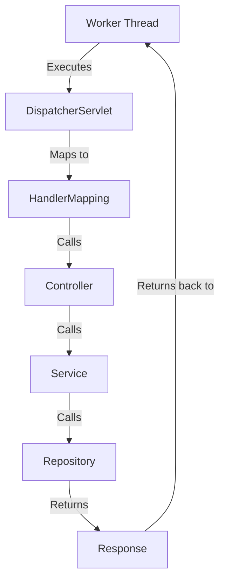

---

```markdown
# 🚀 Demystifying Spring Boot's Request Handling: A Thread's Eye View

Imagine you’ve just built your new Spring Boot application. It seems simple, right? You just run `main()`, and it handles web requests.

But what's **really** happening? This is a perfect case for a visualization.

Here's the problem: The default `main()` method hides the entire complex, beautiful machine that’s running your code. Let's look at the simple version and then mentally expand it to see the truth.

---

## 🧱 The Illusion: The Simple 'main()'

This is the code you write:

```java
public static void main(String[] args) {
    SpringApplication.run(App.class, args);
}

```

This is not the real code, but conceptually, it's very close to what happens behind the scenes.

---

## 🪛 The Blueprint: The Conceptual Expansion

Let's mentally expand that simple `run()` call. You'll see two key components: the **Spring ApplicationContext** (the cupboard of beans) and the **embedded Tomcat server** (the engine that drives everything).

```java
public static void main(String[] args) {

    // 🧱 1. The Spring Container: Builds your app
    ApplicationContext context = new ApplicationContext();
    context.scanPackages();
    context.createBeans(); // Singleton beans are created and stored here.

    // 🪛 2. The Embedded Server: A whole new entity
    Tomcat tomcat = new Tomcat();
    tomcat.createConnector(8080);
    tomcat.createServletContext();
    
    // Connects Spring to Tomcat
    tomcat.register(new DispatcherServlet(context));

    // The key point: this call is a game-changer!
    tomcat.start();  // <-------------------------------- This CREATES THE THREADS!

    // The main thread's job is done. It can finish and exit.
    // THE SERVER THREADS TAKE OVER!
}

```

---

## ☕ The Threads Take Over: Life Inside Tomcat

The crucial part is `tomcat.start()`. It doesn't start a simple loop for your `main()` method. Instead, it fires up long-lived **server threads** that live inside Tomcat. Think of it as opening two different kinds of rooms.

### 1. The Gatekeeper: The Acceptor Thread

This single thread's sole purpose is to listen for new connections. It's like a doorman.

```java
while (true) {
    // 🚦 Waiting for a new connection...
    connection = accept();
    
    // 👋 "Welcome! Please go to the waiting area."
    giveToWorkerPool(connection); 
}
// This thread is VERY fast, which is why your app can handle so many simultaneous connections.
// Its only job is to hand off the work.

```

### 2. The Worker Bees: The Worker Thread Pool

These threads are the heart of your application. They do the actual heavy lifting. Imagine them as a pool of available workers, waiting to pick up a task.

```java
while (true) {
    // 💤 Waiting for work from the Gatekeeper...
    request = waitForWork();

    // 🧑‍💻 The entire lifecycle of a request happens on this single thread.
    DispatcherServlet.service(request);
}
// This is where your code executes! There can be hundreds of these threads running in parallel.

```

---

## ⚡ The Big Picture: When Five Users Send a Request at Once

Now, let's put it all together. Suppose five users send requests at exactly the same time. The acceptor thread is handing off work, and the worker threads spring into action.

### 🔄 Simultaneous Execution of Worker Threads

Each of these lines is executing **simultaneously** on a different, long-lived Tomcat worker thread.

```txt
  Worker-21  --->  GET /users
  Worker-22  --->  POST /login
  Worker-23  --->  GET /courses
  Worker-24  --->  PUT /profile
  Worker-25  --->  DELETE /student/5

```

Each thread independently follows this flow:

### 🧵 A Thread's Journey: The Request Flow



---

## 🧑‍💻 The ApplicationContext: A Passive Cupboard

Here is the single most important part of this entire model:

**The `ApplicationContext` is NOT executing anything.**

It is simply sitting in memory like a giant cupboard full of prepared ingredients (beans). It’s a registry, a repository of singleton instances.

### 🧱 The ApplicationContext "Cupboard"

```txt
ApplicationContext
├── UserController (singleton)
├── CourseController (singleton)
├── LoginController (singleton)
├── UserService (singleton)
├── JwtService (singleton)
└── UserRepository (singleton)
    ... and so on

```

### 🧵 Thread Interaction with the Cupboard

When a worker thread, let's say `Worker-21`, reaches the `DispatcherServlet`, it doesn’t "run" the `ApplicationContext`. It asks it a question:

```txt
Worker-21 (on DispatcherServlet) asks:

    "Can I have the singleton instance of 'UserController', please?"

```

The `ApplicationContext` simply returns a reference to the already-created `UserController` bean. Then, the same `Worker-21` thread continues to execute that bean's methods.

**The same thread goes from `DispatcherServlet` all the way to `Response`.**

---

## 💡 Why This Model Matters

Once you have this mental model in place, advanced Spring concepts become intuitive and easy to understand.

### 🔑 Singleton Beans & Thread Safety

Because multiple threads are accessing and executing the same singleton bean (like `UserController`), you **must ensure your beans are thread-safe**. This is why you should avoid storing mutable state in singleton beans.

### ⏩ @Async

When you annotate a method with `@Async`, it tells Spring to execute that method on a **different thread**, from a separate task executor pool. The original Tomcat worker thread is free to return a response or handle other work, while the async task runs in the background.

### 🚦 Request Scope

Beans with `request` scope are created brand new for each new request. This is because they are meant to hold state that is specific to that one thread’s execution of the request, preventing it from leaking to other threads.

This is the mental model used by backend engineers when reasoning about Spring MVC.

---


```